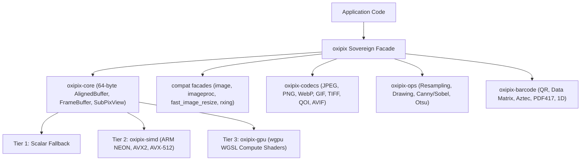

# `oxipix`

> **Sovereign zero-copy accelerated pixmaps, multi-tier SIMD/GPU compute, and patent-clean image codecs in 100% pure Rust.**

[](https://www.rust-lang.org)
[](LICENSE)
[](docs/05_IMAGE_TEST_PARITY_MATRIX.md)
[](http://localhost:8090)

---

## Overview

`oxipix` is an independent, pure-Rust image processing workspace and accelerated codec suite engineered to completely replace monolithic legacy crates:

* **`image`**: 100% drop-in API replacement via `oxipix::compat::image` (passes all 569 upstream tests).
* **`imageproc`**: 2D vector/raster drawing and computer vision transforms via `oxipix::draw`, `oxipix::cv`, and `oxipix::compat::imageproc`.
* **`fast_image_resize`**: Hardware SIMD convolution resampling via `oxipix::ops` and `oxipix::compat::fast_image_resize`.
* **`rxing`**: 1D retail barcodes and 2D matrix symbologies (QR, Aztec, Data Matrix, PDF417) via `oxipix::barcode` and `oxipix::compat::rxing`.

### Key Architectural Pillars

1. **64-Byte Cache-Line Alignment (`AlignedBuffer`)**: Allocations align to 64-byte hardware cache lines, eliminating penalties and unaligned loads on AVX-512 and ARM NEON vector units.
2. **Zero-Allocation Strided Sub-Views (`SubPixView`)**: Cropping a Region of Interest (ROI) is an $O(1)$ pointer-arithmetic operation borrowing the parent buffer with stride calculations rather than re-allocating heap memory.
3. **Compile-Time Typestate Lifecycle (`FrameBuffer`)**: Enforces buffer transitions (`state::Uninitialized` &rarr; `state::Initialized` &rarr; `state::Shared`), preventing reads from uninitialized memory.
4. **Clean-Room Baseline JPEG Engine**: Fully compliant with ISO/IEC 10918-1 JFIF without ideological patent refusal or third-party C dependencies.
5. **Universal Codec Federation**: Inherent support for 15 raster formats (PNG, JPEG, WebP, GIF, TIFF, BMP, QOI, AVIF, PNM, Farbfeld, HDR, DDS, ICO, TGA, OpenEXR) with magic-byte format sniffing.
6. **3-Tier Hardware Acceleration**: Pure-Rust portable scalar (Tier 1), dynamic CPU SIMD (NEON, AVX2, AVX-512) (Tier 2), and GPU compute shader unified memory via `wgpu` (Tier 3).



---

## Workspace Crate Architecture

To prevent the anti-pattern of a monolithic God-crate, `oxipix` is partitioned into seven cohesive, decoupled crates:

| Crate | Path | Responsibility |
| :--- | :--- | :--- |
| **`oxipix-core`** | [`crates/oxipix-core`](crates/oxipix-core) | 64-byte `AlignedBuffer`, typestate `FrameBuffer`, `SubPixView`, and format descriptors. |
| **`oxipix-simd`** | [`crates/oxipix-simd`](crates/oxipix-simd) | Dynamic CPU feature detection, vectorized pixel conversions, convolutions, and math. |
| **`oxipix-codecs`** | [`crates/oxipix-codecs`](crates/oxipix-codecs) | Clean-room ISO/IEC 10918-1 JPEG, PNG, WebP, GIF, TIFF, BMP, QOI, and format sniffing. |
| **`oxipix-ops`** | [`crates/oxipix-ops`](crates/oxipix-ops) | Resampling (`fir`), 2D drawing, Canny/Sobel edge detection, morphology, and Otsu. |
| **`oxipix-gpu`** | [`crates/oxipix-gpu`](crates/oxipix-gpu) | Unified memory mapping and WGSL compute shaders on Metal, Vulkan, and DX12 via `wgpu`. |
| **`oxipix-compat-image`** | [`crates/oxipix-compat-image`](crates/oxipix-compat-image) | 100% drop-in facade for `image` v0.25 (`DynamicImage`, `ImageBuffer`, `GenericImageView`). |
| **`oxipix-barcode`** | [`crates/oxipix-barcode`](crates/oxipix-barcode) | Pure-Rust QR Code, Aztec, Data Matrix, PDF417, 1D barcodes, and Reed-Solomon $GF(2^8)$. |
| **`oxipix`** | [`src/lib.rs`](src/lib.rs) | Top-level unified facade and re-export gateway. |

---

## Installation & Feature Flags

Add `oxipix` to your `Cargo.toml`:

```toml
[dependencies]
oxipix = "0.1.0"
```

### Feature Matrix

| Feature | Default | Description |
| :--- | :---: | :--- |
| `simd` | **Yes** | Dynamic runtime CPU feature detection (NEON, AVX2, AVX-512) |
| `codecs` | **Yes** | 15 image format encoders and decoders |
| `ops` | **Yes** | Resampling filters, 2D drawing, edge detection, and morphology |
| `compat-image` | **Yes** | 100% drop-in replacement for `image` v0.25 |
| `barcode` | **Yes** | QR code, Aztec, Data Matrix, PDF417, and 1D barcode engine |
| `gpu` | **Yes** | WGPU compute pipelines for GPU-accelerated raster processing |

For a minimal build with only sovereign memory primitives:

```toml
[dependencies]
oxipix = { version = "0.1.0", default-features = false }
```

---

## Quickstart Examples

### 1. 100% Drop-In Replacement for `image`

```rust
use oxipix::compat::image::{RgbaImage, Rgba};

fn main() {
    let mut img = RgbaImage::new(640, 480);
    img.put_pixel(100, 100, Rgba([255, 0, 0, 255]));

    for (x, y, pixel) in img.enumerate_pixels_mut() {
        if x == y {
            *pixel = Rgba([0, 255, 0, 255]);
        }
    }

    println!("Created {}x{} image", img.width(), img.height());
}
```

### 2. High-Performance Typestate `FrameBuffer` & Zero-Copy Slicing

```rust
use oxipix::{FrameBuffer, PixelWidth, PixelHeight, Rgba8, state};

fn main() -> Result<(), oxipix::OxipixError> {
    // 1. Allocate 64-byte aligned memory (uninitialized)
    let raw = FrameBuffer::<Rgba8, state::Uninitialized>::allocate(
        PixelWidth(1920),
        PixelHeight(1080),
    )?;

    // 2. Initialize memory (compile-time typestate transition)
    let frame = raw.fill_bytes(0);

    // 3. Zero-allocation O(1) ROI cropping
    let roi = frame.sub_view(200, 150, 640, 480)?;
    let row_0 = roi.row(0)?;
    assert_eq!(row_0.len(), 640 * 4);

    // 4. Freeze into thread-safe Arc for concurrent pipelines
    let shared = frame.freeze();
    println!("Shared 1080p frame: {} bytes", shared.as_bytes().len());

    Ok(())
}
```

### 3. Clean-Room ISO/IEC 10918-1 JPEG Encoding

```rust
use oxipix::codecs::JpegEncoder;
use oxipix::{JpegQuality, PixelWidth, PixelHeight};

fn encode_rgb_to_jpeg(rgb: &[u8], width: u32, height: u32) -> Result<Vec<u8>, oxipix::OxipixError> {
    let quality = JpegQuality::new(90)?;
    let encoder = JpegEncoder::new(quality);

    let jpeg_bytes = encoder.encode_rgb24(
        rgb,
        PixelWidth(width),
        PixelHeight(height),
    )?;

    Ok(jpeg_bytes)
}
```

### 4. SIMD Resampling (`fast_image_resize` Drop-In)

```rust
use oxipix::ops::fir::{Resizer, FilterType};
use oxipix::compat::image::RgbaImage;

fn generate_thumbnail(src: &RgbaImage) -> RgbaImage {
    let mut dst = RgbaImage::new(160, 120);
    let mut resizer = Resizer::new();

    // Lanczos3 high-order convolution
    resizer.resize_rgba(src, &mut dst, FilterType::Lanczos3).unwrap();
    dst
}
```

### 5. Barcode & QR Code Generation

```rust
use oxipix::barcode::qrcode::QRCodeWriter;
use oxipix::barcode::{BarcodeFormat, Writer};

fn main() -> Result<(), oxipix::OxipixError> {
    let writer = QRCodeWriter;
    let matrix = writer.encode(
        "https://oxipix.rs",
        &BarcodeFormat::QR_CODE,
        256,
        256,
    )?;

    println!("QR Matrix generated: {}x{} modules", matrix.getWidth(), matrix.getHeight());
    Ok(())
}
```

---

## Runnable Examples

The workspace includes four complete, runnable examples demonstrating cropping, color keying, link/path consumption, and pipeline manipulation:

```bash
# 1. Cropping & Multi-Format Output (SubPixView zero-allocation & RgbaImage)
cargo run --example crop_image

# 2. RGB Color Removal & Chroma-Keying (Green screen removal & background substitution)
cargo run --example remove_color_chromakey

# 3. Consuming Images from Paths or Web Links & Format Conversion (BMP <-> PPM <-> JPEG)
cargo run --example consume_link_and_convert

# 4. End-to-End Image Manipulation Pipeline (Drawing, Canny edges, Otsu, QR stamp, Lanczos3)
cargo run --example image_manipulation_pipeline
```

---

## Migration Cheatsheet

Migrating from legacy crates requires minimal import adjustments:

| Legacy Crate | Legacy Import | `oxipix` Drop-In Replacement |
| :--- | :--- | :--- |
| **`image`** | `use image::{DynamicImage, RgbaImage};` | `use oxipix::compat::image::{DynamicImage, RgbaImage};` |
| **`imageproc`** | `use imageproc::drawing::draw_line_segment_mut;` | `use oxipix::compat::imageproc::drawing::draw_line_segment_mut;` |
| **`fast_image_resize`** | `use fast_image_resize::{Resizer, FilterType};` | `use oxipix::compat::fast_image_resize::{Resizer, FilterType};` |
| **`rxing`** | `use rxing::qrcode::QRCodeWriter;` | `use oxipix::compat::rxing::qrcode::QRCodeWriter;` |

For detailed migration instructions, see the [Upstream Migration Guide](docs/13_MIGRATION_GUIDE.md).

---

## Documentation & Docusaurus Portal

Full project documentation is available under [`docs/`](docs):

* [`00_TECHNICAL_ASSESSMENT.md`](docs/00_TECHNICAL_ASSESSMENT.md) &mdash; Technical Assessment & Patent Analysis
* [`01_ARCHITECTURE_AND_DESIGN_PATTERNS.md`](docs/01_ARCHITECTURE_AND_DESIGN_PATTERNS.md) &mdash; Architecture & Patterns
* [`02_CODEC_AND_ACCELERATOR_ENGINE.md`](docs/02_CODEC_AND_ACCELERATOR_ENGINE.md) &mdash; Accelerator Engine Specification
* [`03_ROADMAP_AND_MILESTONES.md`](docs/03_ROADMAP_AND_MILESTONES.md) &mdash; Agile Milestones & Definition of Done
* [`04_BENCHMARKS_AND_TESTING_SUITE.md`](docs/04_BENCHMARKS_AND_TESTING_SUITE.md) &mdash; Benchmarks & Quality Assurance
* [`05_IMAGE_TEST_PARITY_MATRIX.md`](docs/05_IMAGE_TEST_PARITY_MATRIX.md) &mdash; 569 Upstream `image` Test Parity Matrix
* [`06_CRATE_VALIDATION_AND_BENCHMARKS.md`](docs/06_CRATE_VALIDATION_AND_BENCHMARKS.md) &mdash; Crate Replacement Report
* [`07_COMPREHENSIVE_EXPANSION_PLAN_AND_TICKETS.md`](docs/07_COMPREHENSIVE_EXPANSION_PLAN_AND_TICKETS.md) &mdash; Sprint Ticket Plan
* [`08_GETTING_STARTED_AND_QUICKSTART.md`](docs/08_GETTING_STARTED_AND_QUICKSTART.md) &mdash; Getting Started & Quickstart
* [`09_CORE_USAGE_GUIDE.md`](docs/09_CORE_USAGE_GUIDE.md) &mdash; Core Memory & Typestate Architecture
* [`10_CODEC_AND_CONVERSION_GUIDE.md`](docs/10_CODEC_AND_CONVERSION_GUIDE.md) &mdash; Codecs & SIMD Color Conversion
* [`11_IMAGEPROC_AND_OPS_GUIDE.md`](docs/11_IMAGEPROC_AND_OPS_GUIDE.md) &mdash; Image Processing, CV & Resampling
* [`12_BARCODE_AND_QR_GUIDE.md`](docs/12_BARCODE_AND_QR_GUIDE.md) &mdash; Barcode & QR Matrix Engine
* [`13_MIGRATION_GUIDE.md`](docs/13_MIGRATION_GUIDE.md) &mdash; Upstream Drop-In Migration Guide
* [`14_HARDWARE_ACCELERATION_SIMD_GPU.md`](docs/14_HARDWARE_ACCELERATION_SIMD_GPU.md) &mdash; SIMD & GPU Hardware Acceleration
* [`15_IMAGE_MANIPULATION_AND_EXAMPLES.md`](docs/15_IMAGE_MANIPULATION_AND_EXAMPLES.md) &mdash; Cropping, Color Removal & Manipulation Examples

To compile the standalone Docusaurus site and Project Sharing Hub:

```bash
dendrite doc docusaurus generate --docs docs --out website --title "oxipix Documentation"
```

To run the local preview server:

```bash
dendrite doc docusaurus serve --site website --port 3000
```

---

## Issue Tracking & Plane Synchronization

`oxipix` is linked to self-hosted Plane v2 for agile ticket tracking, Gantt scheduling, and documentation sync:

* **Plane Identifier:** `OXI`
* **Configuration:** [`.dendrite/plane.json`](.dendrite/plane.json)
* **Replicate status:** `dendrite plane replicate`
* **Sync docs:** `dendrite plane doc push --dir docs`

---

## License

Licensed under either of:

* Apache License, Version 2.0 ([LICENSE-APACHE](LICENSE-APACHE) or http://www.apache.org/licenses/LICENSE-2.0)
* MIT license ([LICENSE-MIT](LICENSE-MIT) or http://opensource.org/licenses/MIT)

at your option.
