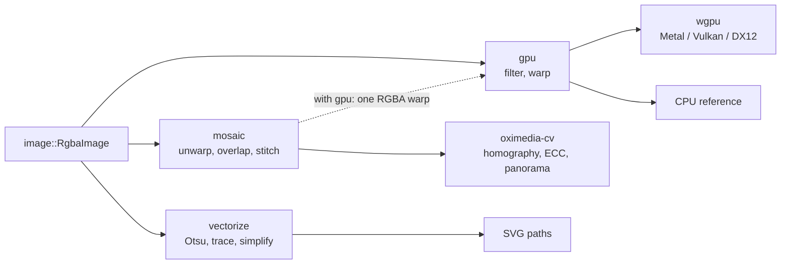

# oxipix

[](https://crates.io/crates/oxipix)
[](https://docs.rs/oxipix)
[](https://github.com/yasuomaidana/oxipix/actions/workflows/ci.yml)
[](https://blog.rust-lang.org/)
[](#license)

**Document-capture building blocks for Rust, on top of the [`image`](https://crates.io/crates/image) crate.**

oxipix turns a phone photograph of a page or receipt into something a recogniser can read: it straightens a tilted
page, stitches overlapping strips, and traces shapes into SVG. An optional wgpu path runs the heavy pixel work on the
GPU (Metal, Vulkan or DX12) and falls back to the CPU when there is no adapter. It is pure Rust: no system OpenCV, no
libclang, no C++ toolchain.

oxipix does not replace `image` or `rxing`. It adds what they deliberately do not have.

| Feature | Default | Module | What it gives you |
|---|---|---|---|
| `mosaic` | yes | `oxipix::mosaic` | Strip overlap detection (zero-mean absolute difference), ECC drift estimation, quadrilateral unwarping, pairwise and multi-frame feathered stitching, luma helpers |
| `vectorize` | yes | `oxipix::vectorize` | Otsu thresholding, Moore-neighbour contour tracing, Ramer-Douglas-Peucker simplification, SVG path output |
| `gpu` | no | `oxipix::gpu` | wgpu 3x3 convolution and bilinear perspective warp on `ImageBuffer<Rgba<u8>, _>` through `GpuImageExt`; pipelines compiled once per process; CPU fallback |

## Install

```toml
[dependencies]
oxipix = "0.1"
image = { version = "0.25", features = ["png", "jpeg"] }
```

oxipix depends on `image` with default features off, so it never decides which codecs you carry. Enable the ones you
need on your own `image` dependency. Opt in to the GPU path with `oxipix = { version = "0.1", features = ["gpu"] }`.

Requires Rust 1.89 or newer.

## Quickstart

Straighten a tilted receipt:

```rust
use image::{Rgba, RgbaImage};
use oxipix::mosaic::unwarp_quad_rgba;

fn main() -> Result<(), oxipix::mosaic::MosaicError> {
    let photo = RgbaImage::from_fn(400, 300, |x, y| Rgba([(x / 2) as u8, (y / 2) as u8, 128, 255]));

    // Corners in the photo: top-left, top-right, bottom-right, bottom-left.
    let corners = [(40.0, 30.0), (360.0, 50.0), (340.0, 270.0), (20.0, 240.0)];
    let page = unwarp_quad_rgba(&photo, &corners, 320, 240)?;

    assert_eq!(page.dimensions(), (320, 240));
    Ok(())
}
```

Trace a shape into SVG:

```rust
use image::{Rgba, RgbaImage};
use oxipix::vectorize::{VectorizeConfig, vectorize_rgba_to_svg};

fn main() {
    let scan = RgbaImage::from_fn(64, 64, |x, y| {
        if (16..48).contains(&x) && (16..48).contains(&y) {
            Rgba([0, 0, 0, 255])
        } else {
            Rgba([255, 255, 255, 255])
        }
    });

    let graphic = vectorize_rgba_to_svg(&scan, VectorizeConfig { grid_step: 1.0, rdp_epsilon: 1.5 });
    assert_eq!(graphic.paths.len(), 1);
    println!("{}", graphic.to_svg_string());
}
```

Blur on the GPU (needs the `gpu` feature; the same call runs on the CPU when no adapter exists):

```rust,ignore
use oxipix::gpu::GpuImageExt;

let blurred = page.gpu_blur3x3();
```

Runnable versions of all three live in [`examples/`](https://github.com/yasuomaidana/oxipix/tree/main/examples): `cargo run --example unwarp_receipt`,
`cargo run --example vectorize_svg`, `cargo run --example gpu_blur --features gpu`.

## How it fits together



## OpenCV-style kernels (`imgproc`)

Fast 8-bit kernels written so the compiler can vectorise them, with the same results as `imageproc`:
`imgproc::template::match_template` (FFT, all four `imageproc` scores), `imgproc::morph` (erode, dilate, open, close,
top-hat, black-hat, gradient) and `imgproc::median::median_blur`, plus `blur`, `pyramid`, `gradient` (Sobel, Laplacian), `canny`, `bilateral` and
`filter2d`. On a 451 x 300 photograph, a 40 x 40 template takes
2.3 ms against 120 ms for `imageproc`, a 5 x 5 median over RGB takes 3.2 ms against 17 ms, and a 5 x 5 erosion of a
303 x 384 mask takes 33 us against 89 us; a Gaussian blur of an RGB photograph takes 0.26 ms against 1.7 ms and
Canny 1.1 ms against 4.9 ms (`cargo bench --bench imgproc_vs_imageproc`, Apple M-series, one thread).
With the `parallel` feature the blur, pyrDown, median, bilateral, warp and `filter2d` kernels split large pictures into row bands on the rayon pool (about a quarter of a megapixel and up; smaller pictures stay on the calling thread because threads cost more than they save). Run inside `rayon::ThreadPoolBuilder::new().num_threads(n).build()?.install(|| ..)` to choose the thread count.
The [rust-cv-guide performance queue](https://github.com/yasuomaidana/rust-cv-guide/blob/main/PERF_QUEUE.md) tracks
the remaining gaps to OpenCV 5.1.0.

## Measured performance

`cargo bench --features gpu --bench gpu_vs_cpu`, Apple M3 (Metal), 1600 x 1200 RGBA, criterion median, **including
upload and readback**:

| Operation | GPU | CPU reference | `imageproc` |
|---|---|---|---|
| 3x3 filter | 4.2 ms | 25.8 ms | 15.1 ms (RGB only) |
| Perspective warp | 4.7 ms | 19.9 ms | n/a |

Small images are faster on the CPU because of transfer overhead; measure at your own sizes before enabling `gpu`. The
CPU reference is a single-threaded specification the shaders must match, not an optimised kernel. Methodology and
fairness rules: [`docs/04_BENCHMARK_METHODOLOGY.md`](https://github.com/yasuomaidana/oxipix/blob/main/docs/04_BENCHMARK_METHODOLOGY.md).

## Compared with the `opencv` crate

|  | oxipix | [`opencv`](https://crates.io/crates/opencv) |
|---|---|---|
| Build requirements | `cargo add`; a Rust toolchain | A system OpenCV 4.x/5.x, libclang and a C++ compiler |
| GPU | wgpu: Metal, Vulkan, DX12 | CUDA modules or OpenCL, depending on how OpenCV was built |
| Scope | Document capture: unwarp, overlap, stitch, vectorize, GPU filter and warp | All of OpenCV |
| Image type | `image::ImageBuffer` | `core::Mat` (BGR by default) |
| Output | Includes SVG | Raster only |

OpenCV is far larger; oxipix covers one slice of it, without a native toolchain. A function-by-function mapping and a
reproducible head-to-head benchmark are planned: see
[`docs/plans/OPENCV_STYLE_DOCS_PLAN.md`](https://github.com/yasuomaidana/oxipix/blob/main/docs/plans/OPENCV_STYLE_DOCS_PLAN.md). Until it lands, no speed claim against
OpenCV is made here.

## Known limitations

- With `gpu`, `unwarp_quad_rgba` fills pixels outside the source with white; the CPU warp clamps to the edge.
- `estimate_orthogonal_drift_ecc` has not been observed to return a non-zero drift (it returned 0 for strips shifted by
  1 to 3 px in our tests). Treat it as a placeholder.
- `auto_dewarp_dominant_quad` finds an outlined page and crops to its bounding box; it does not find filled regions or
  estimate a perspective quad.
- The Moore tracer stops a contour after 1000 steps.

Details and what is planned: [`docs/01_ARCHITECTURE.md`](https://github.com/yasuomaidana/oxipix/blob/main/docs/01_ARCHITECTURE.md) §5 and
[`docs/03_ROADMAP.md`](https://github.com/yasuomaidana/oxipix/blob/main/docs/03_ROADMAP.md).

## Relationship to upstream

CPU-side improvements (SIMD colour conversion, barcode binarizer speed-ups) are developed as opt-in features on forks
of `image` and `rxing` and proposed upstream. See [`docs/FORKS.md`](https://github.com/yasuomaidana/oxipix/blob/main/docs/FORKS.md). The earlier plan to replace those
crates is archived in [`docs/archive`](https://github.com/yasuomaidana/oxipix/tree/main/docs/archive).

## Documentation

| | |
|---|---|
| [`docs/00_MASTER_SPECIFICATIONS.md`](https://github.com/yasuomaidana/oxipix/blob/main/docs/00_MASTER_SPECIFICATIONS.md) | Index of every document, with status |
| [`docs/01_ARCHITECTURE.md`](https://github.com/yasuomaidana/oxipix/blob/main/docs/01_ARCHITECTURE.md) | Design, the GPU path, behaviours to know about |
| [`docs/02_QUALITY_GATES.md`](https://github.com/yasuomaidana/oxipix/blob/main/docs/02_QUALITY_GATES.md) | Every CI gate, its limit and how to run it |
| [`docs/03_ROADMAP.md`](https://github.com/yasuomaidana/oxipix/blob/main/docs/03_ROADMAP.md) | What is done, open and planned |
| [`docs/04_BENCHMARK_METHODOLOGY.md`](https://github.com/yasuomaidana/oxipix/blob/main/docs/04_BENCHMARK_METHODOLOGY.md) | How numbers are measured |
| [`docs/adr/`](https://github.com/yasuomaidana/oxipix/tree/main/docs/adr) | Architecture decision records |
| [`CHANGELOG.md`](https://github.com/yasuomaidana/oxipix/blob/main/CHANGELOG.md) | Release notes |

## Quality

Every change must pass: rustfmt, clippy with `-D warnings`, 100% line coverage, zero duplicated code, cyclomatic
complexity at most 10 and cognitive complexity at most 15 per function, at most 500 lines per file, a feature matrix,
the MSRV, rustdoc without warnings, and `cargo deny`. Behaviour of the public `mosaic` and `vectorize` functions is
pinned by golden-output tests. See [`CONTRIBUTING.md`](https://github.com/yasuomaidana/oxipix/blob/main/CONTRIBUTING.md) and
[`docs/02_QUALITY_GATES.md`](https://github.com/yasuomaidana/oxipix/blob/main/docs/02_QUALITY_GATES.md).

## License

Licensed under either of [Apache License, Version 2.0](https://github.com/yasuomaidana/oxipix/blob/main/LICENSE-APACHE) or [MIT license](https://github.com/yasuomaidana/oxipix/blob/main/LICENSE-MIT) at your option.

Unless you explicitly state otherwise, any contribution intentionally submitted for inclusion in the work by you, as
defined in the Apache-2.0 license, shall be dual licensed as above, without any additional terms or conditions.
