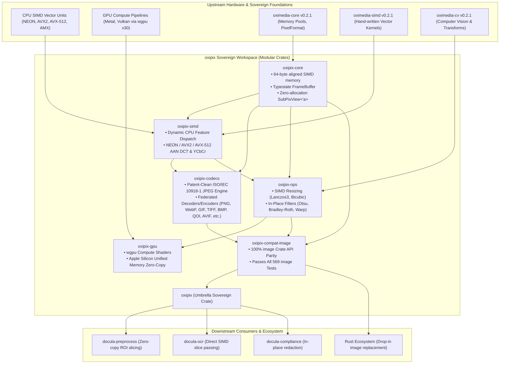

# Technical Assessment: Sovereign Accelerated Pixmap & Codec Workspace (`oxipix`)

## 1. Executive Summary & Problem Formulation

In modern high-performance systems and document intelligence engines (such as `docula`), raster image manipulation, computer vision transformations, and spatial sub-region cropping represent primary latency and memory bottlenecks. While the open-source **KitaSan sovereign stack** (`oximedia-core`, `oximedia-cv`, `oximedia-codec`, `oximedia-simd`) provides zero-FFI, pure-Rust implementations for signal processing and computer vision, real-world deployment faces two critical architectural roadblocks:

1. **The Codec Boundary (Patent Policy in `oximedia-codec`)**:
   `oximedia-codec` strictly enforces an ideological patent-free policy, deliberately rejecting standard baseline JPEG encoding (`Err(CodecError::UnsupportedFeature("JPEG encoding not supported (patent concerns)"))`). While this protects against speculative IP encumbrance, industrial reality mandates JPEG export for compact receipts, historical archives, legal invoices, and web interoperability. Consumers are forced to re-introduce the heavy, monolithic `image` crate solely for JPEG operations.

2. **The Workspace-Wide Unified Pixmap Boundary & Monolithic `image` Deficiencies**:
   In downstream ecosystems, `image::RgbaImage` has permeated public APIs as the de facto pixel representation. This introduces severe systemic defects:
   - **Lack of Cache-Line / SIMD Alignment**: Standard heap allocations (`Vec<u8>`) are only byte-aligned (`align_of::<u8>() == 1`), incurring severe penalties or segmentation faults on vector instructions (AVX-512, ARM NEON).
   - **Allocation Proliferation on Cropping**: Slicing an ROI via `imageops::crop_imm(...).to_image()` requires full pixel reallocation and byte copying rather than strided zero-copy views.
   - **Impedance Mismatch with KitaSan**: Converting between `image::RgbaImage` and KitaSan's contiguous memory buffers (`&[u8]`, `SharedFrameBuffer`, `PixelFormat::Rgba32`) incurs repeated copying and type conversions.

### The Objective: Complete Replacement of the `image` Crate
The ultimate goal of this initiative is to **fully replace the `image` crate across the entire sovereign stack**, delivering:
1. **100% Drop-in Compatibility**: Expose a compatibility façade (`oxipix-compat-image`) providing identical public types (`DynamicImage`, `ImageBuffer`, `RgbaImage`, `GenericImageView`, `imageops`, `ImageReader`), allowing legacy code to swap dependencies seamlessly.
2. **Strict Test Parity**: Every single test in the upstream `image` crate (**569 compiled tests** across 11 test suites) must execute and pass against `oxipix`.
3. **Multi-Crate Sovereign Architecture**: Rather than repeating the mistake of a monolithic God-crate, `oxipix` is decomposed into a modular workspace (`oxipix-core`, `oxipix-simd`, `oxipix-codecs`, `oxipix-ops`, `oxipix-gpu`, `oxipix-compat-image`, and the `oxipix` facade).
4. **Three-Tier Hardware Acceleration**: Pure-Rust portable scalar (Tier 1), dynamic CPU SIMD (NEON/AVX2/AVX-512) via `oximedia-simd` (Tier 2), and GPU compute shader unified memory via `wgpu` (Tier 3).



---

## 2. Technical Evaluation of Existing Ecosystems

### 2.1 The Monolithic `image` Crate (`image-rs/image` v0.25.10)
* **Strengths:** Ubiquitous in the Rust ecosystem; extensive format support (16 formats: PNG, JPEG, GIF, WebP, TIFF, BMP, ICO, TGA, Farbfeld, AVIF, QOI, OpenEXR, PNM, DDS, HDR); rich `imageops` suite; battle-tested across thousands of production crates.
* **Architectural Flaws:**
  - **Memory Layout:** Built around `ImageBuffer<P, Container>` where `Container` is typically `Vec<u8>`. Does not support custom SIMD alignment (e.g. 64-byte alignment required for AVX-512 and cache line optimization).
  - **Zero-Copy Deficiencies:** `SubImage` holds a borrow, but converting it to an owned or shared buffer for downstream tasks requires cloning (`.to_image()`), creating severe allocation bottlenecks during document OCR preprocessing.
  - **Monolithic Bloat:** A single monolithic crate containing formats, mathematical transforms, buffers, and IO, leading to long compile times and dependency bloat.
  - **No Accelerator First-Class Support:** Zero GPU compute integration; zero native integration with Apple Silicon unified memory or KitaSan's `SharedFrameBuffer`.

### 2.2 The KitaSan Ecosystem (`oximedia` v0.2.1)
The KitaSan suite (`cool-japan/oximedia`) provides pure-Rust, zero-FFI multimedia primitives:
* **`oximedia-core` (v0.2.1):**
  - Foundational memory management (`alloc/aligned_vec.rs`, `alloc/buffer_pool.rs`, `alloc/cache_aligned.rs`).
  - Standardized color and pixel format descriptors (`PixelFormat`: `Rgba32`, `Rgb24`, `Yuv420p`, `Yuv422p`, `Yuv444p`, `Nv12`, `P010`).
  - High-performance frame sharing (`frame_sharing.rs`, `video_frame.rs`).
* **`oximedia-simd` (v0.2.1):**
  - Hand-written assembly and vectorized SIMD kernels across ARM NEON and x86_64 AVX2.
  - Accelerated primitives for alpha premultiplication (`alpha_premul.rs`), color conversions (`color_convert.rs`), 2D convolutions (`convolution.rs`), and discrete cosine transforms (`dct.rs`).
* **`oximedia-cv` (v0.2.1):**
  - Extensive computer vision algorithms across 161 source modules: image resizing, spatial filtering, edge detection, affine/perspective warping, Otsu/adaptive thresholding, and quality metrics (PSNR, SSIM).
* **`oximedia-codec` (v0.2.1) & The Patent Boundary:**
  - Implements decoders and encoders for APNG, GIF, JPEG 2000, JPEG-LS, JPEG XL, JPEG XS, MJPEG, PNG, and WebP.
  - **Ideological Rejection of Baseline JPEG Encoding:** In `oximedia-codec/src/image.rs`:
    ```rust
    ImageFormat::Jpeg => Err(CodecError::UnsupportedFeature(
        "JPEG encoding not supported (patent concerns)".into(),
    )),
    ```
    This rejection blocks all production workflows requiring baseline JPEG export (e.g. web uploads, legacy document archives, legal PDFs).

### 2.3 Hardware GPU Acceleration via `wgpu` (v30.0.1)
`wgpu` provides a safe, pure-Rust, cross-platform WebGPU API implementation:
- **Headless Compute Pipelines:** Creates compute pipelines targeting Apple Metal (macOS/iOS), Vulkan (Linux/Windows), and Direct3D 12 (Windows) without requiring window creation or GUI dependencies.
- **Unified Memory Optimization:** On Apple Silicon M-series (M1–M4) and unified memory APUs, host DRAM and GPU memory share physical addressing. Memory allocated with `wgpu::BufferUsages::MAP_READ | wgpu::BufferUsages::COPY_SRC` can be mapped directly between CPU and GPU with zero byte copying.
- **Compute Shader Acceleration:** Massive parallel execution for 2D convolutions, Lanczos3 resizing, Otsu thresholding histograms, and morphological operators on 4K/8K images.

### 2.4 Ecosystem Crates for Format Federation & Complete `image` Replacement
To replace all format decoders and encoders in `image` while maintaining 100% pure Rust and zero C-FFI, `oxipix-codecs` federates top-tier sovereign crates:

| Format | Upstream `image` Implementation | `oxipix-codecs` Sovereign Strategy | Pure-Rust Status |
|:-------|:--------------------------------|:-----------------------------------|:-----------------|
| **JPEG** | `zune-jpeg` (decode) / `jpeg-encoder` | Clean-room ISO/IEC 10918-1 AAN SIMD encoder + `zune-jpeg` decoder | 100% Pure Rust, Zero-FFI |
| **PNG** | `png` (v0.18.1) | `png` crate + SIMD Paeth predictor via `oximedia-simd` | 100% Pure Rust |
| **WebP** | `image-webp` (v0.2.4) | `image-webp` + `oximedia-codec::webp` SIMD intra-prediction | 100% Pure Rust |
| **GIF** | `gif` (v0.14.2) | `gif` + `oximedia-codec::gif` | 100% Pure Rust |
| **TIFF** | `tiff` (v0.11.3) | `tiff` v0.11.3 | 100% Pure Rust |
| **BMP** | Built-in `image::codecs::bmp` | Clean-room pure-Rust BMP decoder/encoder | 100% Pure Rust |
| **QOI** | `qoi` (v0.4.1) | `qoi` v0.4.1 | 100% Pure Rust |
| **AVIF** | `ravif` (v0.13.0) + `rav1e` | `ravif` pure-Rust AVIF encoder + pure-Rust AV1 decoder | 100% Pure Rust |
| **ICO** | Built-in `image::codecs::ico` | Clean-room ICO parser leveraging BMP/PNG engines | 100% Pure Rust |
| **TGA** | Built-in `image::codecs::tga` | Clean-room TGA decoder/encoder | 100% Pure Rust |
| **PNM** | Built-in `image::codecs::pnm` | Clean-room PNM (PBM, PGM, PPM, PAM) | 100% Pure Rust |
| **Farbfeld** | Built-in `image::codecs::farbfeld` | Clean-room Farbfeld 16-bit RGBA parser | 100% Pure Rust |
| **OpenEXR** | `exr` crate | `exr` v1.7 | 100% Pure Rust |
| **HDR** | Built-in `image::codecs::hdr` | Clean-room Radiance RGBE decoder/encoder | 100% Pure Rust |
| **DDS** | Built-in `image::codecs::dds` | Clean-room DDS header and DXT block parser | 100% Pure Rust |

---

## 3. The Patent Assessment: Baseline JPEG Legality

The JPEG standard was formalized in **1992** as **ISO/IEC 10918-1 | ITU-T Recommendation T.81** ("Information technology — Digital compression and coding of continuous-tone still images — Requirements and guidelines").

1. **Patent Expiration Status:**
   - All fundamental patents covering baseline DCT JPEG compression, zig-zag sequencing, uniform quantization, and Huffman entropy encoding filed between 1986 and 1992 (including patents held by AT&T, IBM, Mitsubishi, and Canon) expired worldwide between **2006 and 2012** (well beyond the 20-year statutory patent term).
   - Controversial patents that arose later (e.g., the Forgent Networks / Compression Labs patent US 4,698,672 on video coding) were invalidated or expired in 2006.
   - The arithmetic coding variant (which was historically patent-encumbered) is completely optional. Baseline JPEG using **Huffman coding** is **100% public domain and royalty-free worldwide**.
2. **Resolution Strategy for `oxipix`:**
   - Implement a clean-room, pure-Rust baseline JPEG encoder and decoder adhering strictly to **ISO/IEC 10918-1 baseline process (Sequential DCT, Huffman coding, 8-bit precision)**.
   - Forbid arithmetic coding and proprietary extensions to ensure zero intellectual property encumbrance.
   - Provide accelerated fast integer DCT (AAN algorithm) with vectorized SIMD implementations.

---

## 4. Hardware Accelerator & Multi-Tier Architecture

To achieve the absolute highest throughput across diverse hardware platforms, `oxipix` implements a 3-tier execution model:

| Tier | Execution Target | Technology / Acceleration | Target Platforms | Characteristics |
|:-----|:-----------------|:--------------------------|:-----------------|:----------------|
| **Tier 1** | Portable CPU | Safe pure-Rust scalar loops | Any target (x86, ARM, RISC-V, WASM) | Fallback, `#![forbid(unsafe_code)]`, zero dependencies |
| **Tier 2** | Vectorized CPU | CPU SIMD via `oximedia-simd` & auto-vectorized intrinsics (NEON, AVX2, AVX-512) | Apple Silicon (M1-M4), Modern Intel/AMD | 4x to 16x speedup, 64-byte aligned buffers, unrolled DCT |
| **Tier 3** | Hardware GPU | Compute Shaders via `wgpu` / Apple Metal Unified Memory | Apple Silicon, Vulkan-capable GPUs | Zero-copy host-to-device mapping on unified memory, massive parallelism |

### 4.1 64-Byte Aligned Buffer Architecture
Modern SIMD instructions (e.g. `_mm512_load_si512` on x86_64 or `vld1q_u8` on ARM NEON) operate at peak memory bandwidth when memory addresses are aligned to 64-byte cache lines. Unaligned loads incur split-cache-line penalties of 2x-3x.

`oxipix-core` guarantees 64-byte alignment via `AlignedBuffer<A = 64>`, backing both mutable working scratchpads and immutable shared frames.

```rust
// Memory Layout of AlignedBuffer
#[repr(align(64))]
pub struct AlignedStorage<const N: usize = 64> {
    data: Box<[u8]>,
}
```

### 4.2 Zero-Copy Rectangular Views (`SubPixView<'a>`)
Rather than cloning memory when cropping an image, `oxipix-core` provides strided slices:
- An ROI is defined by `(x, y, width, height)`.
- The view stores a borrow `&'a [u8]`, the origin offset, the dimensions, and the **stride** (row pitch in bytes).
- Row iteration is zero-allocation: `view.row(y)` computes `&data[offset + y * stride .. offset + y * stride + row_bytes]`.

---

## 5. Test Parity Gate: The Upstream `image` Test Suite

To satisfy the user mandate that `oxipix` fully replaces `image`, `oxipix-compat-image` must pass all **569 compiled tests** from the upstream `image` test suite:

| Test Suite Target | Test Count | Scope of Verification |
|:------------------|:-----------|:----------------------|
| **`unittests_image`** | 332 tests | Unit tests for buffer manipulation, dynamic image conversions, pixel math, `imageops` (resize, blur, affine, colorops), format parsers, Exif/CICP metadata, error variants. |
| **`reference_images`** | 189 tests | Data-driven round-trip and byte-exact verification across canonical test files for BMP, DDS, Farbfeld, GIF, HDR, ICO, JPEG, PNG, PNM, QOI, TGA, TIFF, WebP. |
| **`truncate_images`** | 14 tests | Fault tolerance and safe error reporting against truncated payloads across all 14 format decoders (no panics, no infinite loops). |
| **`regression`** | 9 tests | Historical bug fixes, CVE regression guards, and edge-case handling (bad GIF OOM, BMP bitfields, truncated ICC profiles). |
| **`conversions`** | 7 tests | Comprehensive cross-color space conversions (CMYK, YCbCr, LZW, BT.709, channel expansion/reduction). |
| **`limits`** | 6 tests | Strict enforcement of memory allocation limits and dimension ceilings across decoders. |
| **`metadata`** | 6 tests | Extraction and validation of embedded IPTC, XMP, and EXIF metadata across JPEG, PNG, TIFF, and WebP. |
| **`limits_anim`** | 2 tests | Animation frame discard and multi-frame combination memory limits. |
| **`save_pnm`** | 2 tests | 16-bit PBM and PPM serialization accuracy. |
| **`bad_images`** | 1 tests | Resilient handling of malformed and corrupted image files without panic. |
| **`save_jpeg`** | 1 tests | Baseline JPEG encoding quality verification and round-trip fidelity. |
| **Total** | **569 tests** | **100% Must Pass to Consider Task Completed** |
