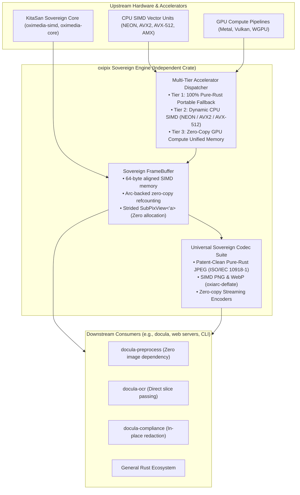

# Technical Assessment: Sovereign Accelerated Pixmap & Codec Architecture (`oxipix`)

## 1. Executive Summary & Problem Formulation

In modern high-performance systems and document intelligence engines (such as `docula`), raster image manipulation, computer vision transformations, and spatial sub-region cropping represent primary latency and memory bottlenecks. While the open-source **KitaSan sovereign stack** (`oximedia-core`, `oximedia-cv`, `oximedia-codec`, `oximedia-simd`) provides zero-FFI, pure-Rust implementations for signal processing and computer vision, real-world deployment faces two critical architectural roadblocks:

1. **The Codec Boundary (Patent Policy in `oximedia-codec`)**:
   `oximedia-codec` strictly enforces an ideological patent-free policy, deliberately rejecting standard baseline JPEG encoding (`Err(CodecError::UnsupportedFeature("JPEG encoding not supported (patent concerns)"))`). While this protects against speculative IP encumbrance, industrial reality mandates JPEG export for compact receipts, historical archives, legal invoices, and web interoperability. Consumers are forced to re-introduce the heavy, monolithic `image` crate solely for JPEG operations.

2. **The Workspace-Wide Unified Pixmap Boundary**:
   In downstream ecosystems, `image::RgbaImage` has permeated public APIs as the de facto pixel representation. This introduces severe systemic defects:
   - **Lack of Cache-Line / SIMD Alignment**: Standard heap allocations (`Vec<u8>`) are only byte-aligned (`align_of::<u8>() == 1`), incurring severe penalties or segmentation faults on vector instructions (AVX-512, ARM NEON).
   - **Allocation Proliferation on Cropping**: Slicing an ROI via `imageops::crop_imm(...).to_image()` requires full pixel reallocation and byte copying rather than strided zero-copy views.
   - **Impedance Mismatch with KitaSan**: Converting between `image::RgbaImage` and KitaSan's contiguous memory buffers (`&[u8]`, `SharedFrameBuffer`, `PixelFormat::Rgba32`) incurs repeated copying and type conversions.

### The Objective
To solve these limitations without compromising the pure-Rust, zero-FFI mandate, we design **`oxipix`**: an independent, general-purpose, sovereign Rust crate dedicated to **zero-copy accelerated pixmaps, multi-tier hardware acceleration, and patent-clean image codecs**.



---

## 2. Technical Evaluation of Existing Ecosystems

### 2.1 The Monolithic `image` Crate (`image-rs/image`)
* **Strengths:** Ubiquitous in the Rust ecosystem; supports a broad variety of legacy formats; straightforward high-level API.
* **Architectural Flaws:**
  - **Memory Layout:** Built around `ImageBuffer<P, Container>` where `Container` is typically `Vec<u8>`. Does not support custom SIMD alignment (e.g. 64-byte alignment required for AVX-512 and cache line optimization).
  - **Zero-Copy Deficiencies:** `SubImage` holds a borrow, but converting it to an owned or shared buffer for downstream tasks requires copying (`.to_image()`).
  - **Bloat & Complexity:** Massive dependency graph, slow compile times, and lack of typestate lifecycle tracking.
  - **No Accelerator First-Class Support:** No integration with GPU compute buffers, Apple Silicon unified memory, or KitaSan's `SharedFrameBuffer`.

### 2.2 The KitaSan Ecosystem (`oximedia`)
* **Strengths:** 100% pure Rust (`fail0 + Clippy0`); sovereign implementation of computer vision (`oximedia-cv`) and SIMD vector operations (`oximedia-simd`); zero external C dynamic linkage (`cargo-geiger` 100% clean).
* **Current Limitations:**
  - **Ideological Codec Rejection:** In `oximedia-codec/src/image.rs`, line 517:
    ```rust
    ImageFormat::Jpeg => Err(CodecError::UnsupportedFeature(
        "JPEG encoding not supported (patent concerns)".into(),
    )),
    ```
    This rejection blocks all production workflows that must export JPEG format.
  - **No Universal Public Pixmap Facade:** KitaSan provides low-level building blocks (`SharedFrameBuffer`, `VideoFrame`, `MutableFrameBuffer`), but lacks an ergonomic, high-level image manipulation and slicing abstraction suitable for general-purpose applications.

---

## 3. The Patent Assessment: Baseline JPEG Legality

The JPEG standard was formalized in **1992** as **ISO/IEC 10918-1 | ITU-T Recommendation T.81** ("Information technology — Digital compression and coding of continuous-tone still images — Requirements and guidelines").

1. **Patent Expiration Status:**
   - All fundamental patents covering baseline DCT JPEG compression, zig-zag sequencing, uniform quantization, and Huffman entropy encoding filed between 1986 and 1992 (including patents held by AT&T, IBM, Mitsubishi, and Canon) expired worldwide between **2006 and 2012** (well beyond the 20-year statutory patent term).
   - Controversial patents that arose later (e.g., the Forgent Networks / Compression Labs patent US 4,698,672 on video coding) were invalidated or expired in 2006.
   - The arithmetic coding variant (which was historically patent-encumbered) is completely optional. Baseline JPEG using **Huffman coding** is **100% public domain and royalty-free worldwide**.
2. **Resolution Strategy for `oxipix`:**
   - Implement a clean-room, pure-Rust baseline JPEG encoder and decoder adhering strictly to **ISO/IEC 10918-1 baseline process (Sequential DCT, Huffman coding, 8-bit precision)**.
   - Forbid arithmetic coding and proprietary extensions to ensure zero intellectual property encumbrance.
   - Provide accelerated fast integer DCT (AAN algorithm) with vectorized SIMD implementations.

---

## 4. Hardware Accelerator & Multi-Tier Architecture

To achieve the absolute highest throughput across diverse hardware platforms, `oxipix` implements a 3-tier execution model:

| Tier | Execution Target | Technology / Acceleration | Target Platforms | Characteristics |
|:-----|:-----------------|:--------------------------|:-----------------|:----------------|
| **Tier 1** | Portable CPU | Safe pure-Rust scalar loops | Any target (x86, ARM, RISC-V, WASM) | Fallback, `#![forbid(unsafe_code)]`, zero dependencies |
| **Tier 2** | Vectorized CPU | CPU SIMD via `oximedia-simd` & auto-vectorized intrinsics (NEON, AVX2, AVX-512) | Apple Silicon (M1-M4), Modern Intel/AMD | 4x to 16x speedup, 64-byte aligned buffers, unrolled DCT |
| **Tier 3** | Hardware GPU | Compute Shaders via `wgpu` / Apple Metal Unified Memory | Apple Silicon, Vulkan-capable GPUs | Zero-copy host-to-device mapping on unified memory, massive parallelism |

### 4.1 64-Byte Aligned Buffer Architecture
Modern SIMD instructions (e.g. `_mm512_load_si512` on x86_64 or `vld1q_u8` on ARM NEON) operate at peak memory bandwidth when memory addresses are aligned to 64-byte cache lines. Unaligned loads incur split-cache-line penalties of 2x-3x.

`oxipix` guarantees 64-byte alignment via `AlignedBuffer<A = 64>`, backing both mutable working scratchpads and immutable shared frames.

```rust
// Memory Layout of AlignedBuffer
#[repr(align(64))]
pub struct AlignedStorage<const N: usize = 64> {
    data: Box<[u8]>,
}
```

### 4.2 Zero-Copy Rectangular Views (`SubPixView<'a>`)
Rather than cloning memory when cropping an image, `oxipix` provides strided slices:
- An ROI is defined by `(x, y, width, height)`.
- The view stores a borrow `&'a [u8]`, the origin offset, the dimensions, and the **stride** (row pitch in bytes).
- Row iteration is zero-allocation: `view.row(y)` computes `&data[offset + y * stride .. offset + y * stride + row_bytes]`.

---

## 5. Architectural Boundary Separation

To ensure clean system architecture and adherence to enterprise software guidelines:
- **Zero Coupling with `docula`**: `oxipix` has zero knowledge of documents, bounding boxes, OCR, PDF parsing, or AST structures. It is purely an image, pixmap, and codec engine.
- **Independence from External FFI**: 100% pure Rust. Zero dynamic or static C/C++ dependencies (`libjpeg`, `libpng`, `OpenCV`).
- **First-Class Interoperability**: Direct, zero-copy converters to/from:
  - Raw slices (`&[u8]`, `&mut [u8]`)
  - KitaSan types (`oximedia_core::frame_sharing::SharedFrame`, `oximedia_core::types::PixelFormat`)
  - `tiny-skia::PixmapMut` / `tiny-skia::Pixmap`
  - Optional feature gates for compatibility with legacy `image` crate during transition periods.
