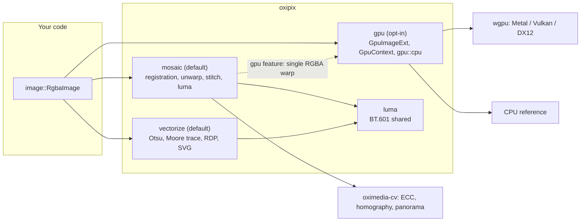

# 01 — Architecture

| | |
|---|---|
| Status | Current (replaces the archived seven-crate design in [`archive/`](archive/)) |
| Applies to | `oxipix` 0.1.x |
| Decision record | [ADR-0001](adr/0001-single-crate-on-top-of-image.md) |

## 1. Shape of the crate

oxipix is **one crate** with three feature-gated modules. It builds on the [`image`](https://crates.io/crates/image)
crate's `ImageBuffer` and does not define its own pixel container.



| Feature | Default | Module | Extra dependencies |
|---|---|---|---|
| `mosaic` | yes | `oxipix::mosaic` | `oximedia-cv`, `thiserror` |
| `vectorize` | yes | `oxipix::vectorize` | none |
| `gpu` | no | `oxipix::gpu` | `wgpu`, `pollster`, `bytemuck`, `thiserror` |

`vectorize` has no dependency beyond `image`. The shared BT.601 luma helpers live in a private `luma` module that is
compiled when either `mosaic` or `vectorize` is on; `mosaic::luma` re-exports them so the public paths stay stable.

## 2. The GPU path

- **One process-wide context.** `GpuContext::global()` creates the wgpu device on first use and compiles both
  compute pipelines (3x3 convolution, perspective warp) once, stored in a `OnceLock<Option<GpuContext>>`. It returns
  `None` when no adapter exists.
- **Automatic CPU fallback.** `GpuImageExt` (implemented for `ImageBuffer<Rgba<u8>, _>`) tries the GPU and falls back to
  [`gpu::cpu`] when there is no adapter or the GPU call returns a `GpuError`. Callers never branch. `GpuError`
  surfaces only if you call `GpuContext` directly.
- **The CPU module is the specification.** `gpu::cpu::convolve3x3` and `gpu::cpu::warp_perspective` define the
  semantics the WGSL kernels must match: truncating quantisation, clamp-to-edge convolution, white for samples outside
  the source. `gpu` unit tests compare the two.
- **Transfer cost is real.** Every call uploads the image and reads the result back. Small images are faster on the
  CPU; see [benchmark methodology](04_BENCHMARK_METHODOLOGY.md).

## 3. The mosaic module

| Concern | Public items | Notes |
|---|---|---|
| Brightness | `rgb_to_luma_u8`, `rgba_to_luma_vec`, `map_rgb_channels`, `map_rgba_channels` | BT.601 weights. Registration deliberately uses the plain channel mean instead; see §5. |
| Overlap search | `detect_strip_overlap_zmad`, `OverlapAxis` | Zero-mean absolute difference over a sparse sample grid (about 15 depths, every third cross position). |
| Drift | `estimate_orthogonal_drift_ecc` | ECC translation refinement through `oximedia-cv`. |
| Unwarp | `unwarp_quad_rgba`, `auto_dewarp_dominant_quad` | Axis-aligned quads are a plain crop; otherwise a homography (`oximedia-cv`) and either the single-pass GPU warp or a per-channel CPU warp. |
| Stitch | `stitch_pair_vertical`, `stitch_pair_horizontal`, `stitch_frames_feathered` | Pairwise cross-fade is oxipix's own; multi-frame feathering uses `oximedia-cv`'s panorama stitcher. |

## 4. The vectorize module

`vectorize_rgba_to_svg` converts to luma, picks a threshold with `otsu_threshold`, samples a boolean grid every
`grid_step` pixels (a pixel is set when its luma is `<=` the threshold), traces boundaries with
`trace_moore_neighbor_contours`, simplifies each contour with `simplify_rdp` and returns a `VectorizedGraphic` that
serialises with `to_svg_string`. Each contour is cut off after 1000 steps.

## 5. Behaviours to know about

These are properties of the current implementation, recorded so they are not mistaken for bugs or silently changed:

1. **GPU and CPU warps differ at the border.** With `gpu` on, `unwarp_quad_rgba` fills pixels that map outside the
   source with white; the CPU warp edge-clamps.
2. **Two brightness definitions.** `rgb_to_luma_u8` uses BT.601 weights. Registration (`detect_strip_overlap_zmad`,
   `estimate_orthogonal_drift_ecc`) uses the integer mean of the three channels. Changing it would change the
   overlap search results of downstream users, so it is pinned by the characterization tests.
3. **`estimate_orthogonal_drift_ecc` has not been observed to return a non-zero drift.** In tests on smooth
   sinusoidal strips shifted by 1, 2 and 3 pixels, `oximedia-cv`'s ECC converged to translations of about
   -0.0006, -0.0011 and -0.0016 px, which round to 0. Treat the function as a placeholder until it is fixed or
   replaced (see [roadmap](03_ROADMAP.md), RM-ECC).
4. **`auto_dewarp_dominant_quad` finds outlines, not filled regions.** `oximedia-cv`'s `ContourFinder` reports a
   filled rectangle as a nest of concentric rings whose areas fall below the minimum, so a solid page on a dark
   background yields no candidate. A one-pixel outline does. The function crops to the contour's bounding box; it
   does not estimate a perspective quad.
5. **The Moore tracer caps each contour at 1000 steps.**

## 6. Module and file layout

```text
src/
  lib.rs                 crate docs (README), feature gates
  luma.rs                BT.601 luma (private, shared)
  gpu/{context,cpu,ext,shaders,mod}.rs
  mosaic/{registration,perspective,stitch,luma,error,mod}.rs
  vectorize/{contour,mod}.rs
tests/
  characterization*.rs   golden hashes of every public output
benches/gpu_vs_cpu.rs
examples/                unwarp_receipt, vectorize_svg, gpu_blur
```

Every production file is under 500 lines, every function under cyclomatic 10 and cognitive 15 — see
[quality gates](02_QUALITY_GATES.md).
