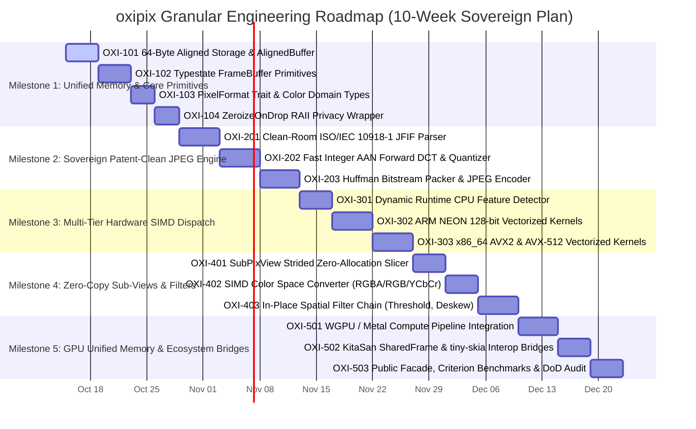

# Granular Roadmap & Agile Milestones: `oxipix`

## 1. Scrum Master Alignment & Definition of Done (DoD)

In strict accordance with the **Agile Scrum Master & Goal Alignment Protocol**, all functional deliverables for `oxipix` adhere to the enterprise **Definition of Done (DoD)**:

1. **Goal Traceability**: Every requirement and user story has automated tests validating both happy paths and edge cases.
2. **Deterministic Code Quality**: Zero Clippy warnings (`-D warnings`), zero panics, zero `.unwrap()` or `.expect()` in non-test production code.
3. **Complexity Gates**: Cyclomatic Complexity (CC) $\le 10$ (hard ceiling $\le 15$), Cognitive Complexity $\le 15$ (hard ceiling $\le 20$), function length $\le 80$ lines.
4. **Coverage Threshold**: Code coverage $\ge 85\%$ measured via `cargo llvm-cov`.
5. **Persistence & Asset DoD ([Testcontainers](https://rust.testcontainers.org))**: Any persistent asset caching, benchmark baseline repository, or fixture verification servers must be integration tested using real throwaway containers managed by `testcontainers`.

---

## 2. Granular Phased Milestone Breakdown

---

## 3. Milestone Specifications & Ticket Definitions

### Milestone 1: Unified Memory & Core Primitives

#### Ticket OXI-101: 64-Byte Aligned Storage & `AlignedBuffer`
* **Reference Spec:** [`00_TECHNICAL_ASSESSMENT.md`](file:///Users/yasuomaidana/RustRoverProjects/docula/docs/oxipix/00_TECHNICAL_ASSESSMENT.md)
* **Single Responsibility:** Implement `AlignedBuffer<const ALIGN: usize = 64>` guaranteeing cache-line and vector alignment without unaligned heap penalties.
* **Design Pattern:** **RAII Pattern** & **Custom Allocator Bridge**.
* **Acceptance Criteria:**
  1. Base pointer address satisfies `ptr as usize % 64 == 0`.
  2. Implements `Deref` and `DerefMut` to `[u8]`.
  3. Reclaims memory via `std::alloc::dealloc` on drop with identical layout.
  4. Returns `PixError::AllocationOverflow` if size exceeds address space.
* **Test Scenarios:**
  * `test_aligned_buffer_64byte_pointer`: Verifies pointer address modulo 64 is 0.
  * `test_aligned_buffer_reallocation_growth`: Verifies memory safety during resizing.

#### Ticket OXI-102: Typestate `FrameBuffer` Primitives
* **Reference Spec:** [`01_ARCHITECTURE_AND_DESIGN_PATTERNS.md`](file:///Users/yasuomaidana/RustRoverProjects/docula/docs/oxipix/01_ARCHITECTURE_AND_DESIGN_PATTERNS.md)
* **Single Responsibility:** Implement `FrameBuffer<Format, State>` with typestates `Uninitialized`, `Initialized`, `Shared`.
* **Design Pattern:** **Typestate Pattern** & **Zero-Sized Types (ZST)**.
* **Acceptance Criteria:**
  1. Prevents reads on `Uninitialized` at compile-time.
  2. `freeze()` consumes `Initialized` and transitions to `Shared` backed by `Arc<[u8]>`.
  3. `make_mut()` enables copy-on-write semantics when reference count is 1.
* **Test Scenarios:**
  * `test_typestate_compile_time_safety`: Compile-fail test verifying uninitialized reads are impossible.
  * `test_shared_frame_cow_semantics`: Mutating shared frame with ref count > 1 safely clones backing store.

#### Ticket OXI-103: `PixelFormat` Trait & Color Domain Types
* **Reference Spec:** [`01_ARCHITECTURE_AND_DESIGN_PATTERNS.md`](file:///Users/yasuomaidana/RustRoverProjects/docula/docs/oxipix/01_ARCHITECTURE_AND_DESIGN_PATTERNS.md)
* **Single Responsibility:** Define zero-cost `PixelFormat` trait and implementations: `Rgba8`, `Rgb8`, `Luma8`, `Bgra8`.
* **Design Pattern:** **Strategy Pattern** & **Newtype Pattern**.
* **Acceptance Criteria:**
  1. Constants `BYTES_PER_PIXEL`, `CHANNELS`, and byte layouts compile to zero-cost inline constants.
  2. Casting via `bytemuck::Pod` and `bytemuck::Zeroable` requires zero heap allocation.
* **Test Scenarios:**
  * `test_pixel_format_byte_sizes`: Assert byte strides match exact struct sizes.
  * `test_bytemuck_cast_safety`: Verify zero-copy transmutation between raw bytes and pixel tuples.

#### Ticket OXI-104: `ZeroizeOnDropFrame` RAII Privacy Wrapper
* **Reference Spec:** [`01_ARCHITECTURE_AND_DESIGN_PATTERNS.md`](file:///Users/yasuomaidana/RustRoverProjects/docula/docs/oxipix/01_ARCHITECTURE_AND_DESIGN_PATTERNS.md)
* **Single Responsibility:** Provide safe memory-clearing wrapper that wipes sensitive pixel buffers upon drop.
* **Design Pattern:** **RAII Pattern** & **Decorator Pattern**.
* **Acceptance Criteria:**
  1. Overwrites memory with `0x00` before freeing.
  2. Compiler optimizer does not eliminate dead memory writes (`zeroize::zeroize_mem`).
* **Test Scenarios:**
  * `test_zeroize_on_drop_wipes_memory`: Memory inspect verifies cleared bytes before deallocation.

---

### Milestone 2: Sovereign Patent-Clean JPEG Engine

#### Ticket OXI-201: Clean-Room ISO/IEC 10918-1 JFIF Parser & Bitstream Writer
* **Reference Spec:** [`02_CODEC_AND_ACCELERATOR_ENGINE.md`](file:///Users/yasuomaidana/RustRoverProjects/docula/docs/oxipix/02_CODEC_AND_ACCELERATOR_ENGINE.md)
* **Single Responsibility:** Implement markers `SOI`, `SOF0`, `DQT`, `DHT`, `SOS`, `EOI` and bitstream packer with zero FFI.
* **Design Pattern:** **Builder Pattern** & **Streaming BitWriter**.
* **Acceptance Criteria:**
  1. Emits valid JFIF headers readable by standard image viewers.
  2. Pure Rust with zero external C dependencies.
  3. Handles byte-stuffing (`0xFF` followed by `0x00`).
* **Test Scenarios:**
  * `test_jfif_header_structure`: Validates emitted markers against ISO/IEC 10918-1 specifications.
  * `test_byte_stuffing_safety`: Ensures `0xFF` byte emission is correctly stuffed with `0x00`.

#### Ticket OXI-202: Fast Integer AAN Forward DCT & Quantizer
* **Reference Spec:** [`02_CODEC_AND_ACCELERATOR_ENGINE.md`](file:///Users/yasuomaidana/RustRoverProjects/docula/docs/oxipix/02_CODEC_AND_ACCELERATOR_ENGINE.md)
* **Single Responsibility:** Implement 8x8 2D Forward DCT using the Arai, Agneche, and Bellas integer algorithm with scaled quantization tables.
* **Design Pattern:** **Mathematical Factorization** & **Pipeline Pattern**.
* **Acceptance Criteria:**
  1. Computes 2D DCT in 5 multiplications per row/column.
  2. Quantizes and orders coefficients via zig-zag table.
  3. Reconstructible within $\text{PSNR} > 38 \text{ dB}$ on standard test images.
* **Test Scenarios:**
  * `test_aan_dct_known_matrix`: Tests uniform flat block produces DC coefficient only.
  * `test_zigzag_reordering`: Validates natural 8x8 order correctly maps to 1D zig-zag array.

#### Ticket OXI-203: Huffman Bitstream Packer & Complete JPEG Encoder
* **Reference Spec:** [`02_CODEC_AND_ACCELERATOR_ENGINE.md`](file:///Users/yasuomaidana/RustRoverProjects/docula/docs/oxipix/02_CODEC_AND_ACCELERATOR_ENGINE.md)
* **Single Responsibility:** Implement luminance and chrominance DC/AC Huffman coding and expose `JpegEncoder::encode`.
* **Design Pattern:** **Facade Pattern** & **Strategy Pattern**.
* **Acceptance Criteria:**
  1. Supports configurable `JpegQuality(1..=100)`.
  2. Encodes RGBA8 and RGB8 buffers into standard `.jpg` byte vector.
  3. Zero panics on malformed dimensions.
* **Test Scenarios:**
  * `test_encode_synthetic_gradient_jpeg`: Produces valid JPEG conforming to target quality.
  * `test_roundtrip_with_external_decoder`: Encoded byte stream verifies cleanly in third-party decoders.

---

### Milestone 3: Multi-Tier Hardware SIMD Dispatch

#### Ticket OXI-301: Dynamic Runtime CPU Feature Detector & Dispatch Trait
* **Reference Spec:** [`02_CODEC_AND_ACCELERATOR_ENGINE.md`](file:///Users/yasuomaidana/RustRoverProjects/docula/docs/oxipix/02_CODEC_AND_ACCELERATOR_ENGINE.md)
* **Single Responsibility:** Detect AVX-512, AVX2, and ARM NEON capabilities at runtime, selecting the optimal vector kernel.
* **Design Pattern:** **Abstract Factory** & **Dynamic Dispatch Table**.
* **Acceptance Criteria:**
  1. Detects host features without runtime panics or SIGILL.
  2. Gracefully falls back to Tier 1 scalar implementation if SIMD is unavailable.
* **Test Scenarios:**
  * `test_runtime_feature_detection`: Reports exact CPU extensions on host machine.
  * `test_scalar_fallback_equivalence`: Assert identical pixel results between scalar and vector paths.

#### Ticket OXI-302: ARM NEON 128-bit Vectorized Kernels
* **Reference Spec:** [`02_CODEC_AND_ACCELERATOR_ENGINE.md`](file:///Users/yasuomaidana/RustRoverProjects/docula/docs/oxipix/02_CODEC_AND_ACCELERATOR_ENGINE.md)
* **Single Responsibility:** Implement NEON vector instructions for color space conversion and DCT butterflies on Apple Silicon / AArch64.
* **Design Pattern:** **Vector SIMD Pipeline**.
* **Acceptance Criteria:**
  1. Processes 16 bytes per iteration using `vld1q_u8` and `vst1q_u8`.
  2. Achieves $\ge 3\times$ speedup over portable scalar baseline on M-series chips.
* **Test Scenarios:**
  * `test_neon_color_conversion_accuracy`: Compares NEON RGB->YCbCr output with scalar reference.

#### Ticket OXI-303: x86_64 AVX2 & AVX-512 Vectorized Kernels
* **Reference Spec:** [`02_CODEC_AND_ACCELERATOR_ENGINE.md`](file:///Users/yasuomaidana/RustRoverProjects/docula/docs/oxipix/02_CODEC_AND_ACCELERATOR_ENGINE.md)
* **Single Responsibility:** Implement AVX2 (256-bit) and AVX-512 (512-bit) vector kernels using `oximedia-simd`.
* **Design Pattern:** **Vector SIMD Pipeline**.
* **Acceptance Criteria:**
  1. Leverages 256/512-bit registers with 64-byte aligned loads.
  2. Achieves $\ge 4\times$ speedup on Intel/AMD AVX2+ processors.
* **Test Scenarios:**
  * `test_avx2_dct_quantization_parity`: Validates AVX2 quantization parity with scalar reference.

---

### Milestone 4: Zero-Copy Sub-Views & Spatial Filters

#### Ticket OXI-401: `SubPixView` Strided Zero-Allocation Slicer
* **Reference Spec:** [`01_ARCHITECTURE_AND_DESIGN_PATTERNS.md`](file:///Users/yasuomaidana/RustRoverProjects/docula/docs/oxipix/01_ARCHITECTURE_AND_DESIGN_PATTERNS.md)
* **Single Responsibility:** Implement `SubPixView<'a, Format>` providing zero-allocation borrows for arbitrary bounding rectangles.
* **Design Pattern:** **Flyweight Pattern** & **View Pattern**.
* **Acceptance Criteria:**
  1. Slicing an ROI executes in $O(1)$ time and 0 heap allocations.
  2. Strided row iteration validates row boundaries safely.
  3. Slices can be encoded directly into JPEG/PNG without cloning parent buffer.
* **Test Scenarios:**
  * `test_sub_pix_view_zero_alloc`: Benchmark confirms zero allocations during view slicing.
  * `test_sub_pix_view_out_of_bounds`: Rectangles exceeding source dimensions return `PixError::OutOfBounds`.

#### Ticket OXI-402: SIMD Color Space Converter (RGBA $\leftrightarrow$ RGB $\leftrightarrow$ YCbCr)
* **Reference Spec:** [`02_CODEC_AND_ACCELERATOR_ENGINE.md`](file:///Users/yasuomaidana/RustRoverProjects/docula/docs/oxipix/02_CODEC_AND_ACCELERATOR_ENGINE.md)
* **Single Responsibility:** High-speed vectorized color conversion between standard formats.
* **Design Pattern:** **Strategy Pattern**.
* **Acceptance Criteria:**
  1. Strips alpha channel (RGBA $\to$ RGB) at $> 3.5 \text{ GB/s}$ on modern hardware.
  2. Reversible conversion maintains color accuracy within standard roundoff ($< \pm 1$ LSB).
* **Test Scenarios:**
  * `test_rgba_to_rgb_simd_parity`: Verifies stripped alpha channel matches expected byte pattern.

#### Ticket OXI-403: In-Place Spatial Filter Chain (Adaptive Threshold & Deskew)
* **Reference Spec:** [`02_CODEC_AND_ACCELERATOR_ENGINE.md`](file:///Users/yasuomaidana/RustRoverProjects/docula/docs/oxipix/02_CODEC_AND_ACCELERATOR_ENGINE.md)
* **Single Responsibility:** Implement Otsu, Bradley-Roth adaptive binarization, and bilinear warp deskew directly on `FrameBuffer`.
* **Design Pattern:** **Pipeline Pattern**.
* **Acceptance Criteria:**
  1. Operates in-place on mutable buffers without secondary buffer allocations.
  2. SIMD-accelerated integral image computation.
* **Test Scenarios:**
  * `test_adaptive_binarize_gradient`: Gradient image cleanly segments into binary mask.

---

### Milestone 5: GPU Unified Memory & Ecosystem Bridges

#### Ticket OXI-501: WGPU / Metal Compute Pipeline Integration
* **Reference Spec:** [`02_CODEC_AND_ACCELERATOR_ENGINE.md`](file:///Users/yasuomaidana/RustRoverProjects/docula/docs/oxipix/02_CODEC_AND_ACCELERATOR_ENGINE.md)
* **Single Responsibility:** GPU hardware acceleration module featuring unified memory zero-copy mapping and compute shaders.
* **Design Pattern:** **Adapter Pattern** & **Hardware Acceleration Bridge**.
* **Acceptance Criteria:**
  1. Gated behind optional `gpu` cargo feature.
  2. Dispatches compute shaders for heavy morphological operations.
  3. Automatic fallback to SIMD Tier 2 if no GPU adapter is found.
* **Test Scenarios:**
  * `test_gpu_compute_fallback`: When GPU is disabled or mock headless, smoothly falls back to Tier 2.

#### Ticket OXI-502: KitaSan `SharedFrame` & `tiny-skia` Interop Bridges
* **Reference Spec:** [`00_TECHNICAL_ASSESSMENT.md`](file:///Users/yasuomaidana/RustRoverProjects/docula/docs/oxipix/00_TECHNICAL_ASSESSMENT.md)
* **Single Responsibility:** Provide zero-cost conversion traits `From` and `Into` for `oximedia_core::frame_sharing::SharedFrame` and `tiny_skia::PixmapMut`.
* **Design Pattern:** **Adapter Pattern**.
* **Acceptance Criteria:**
  1. Transmutes `oximedia_core::SharedFrameBuffer` without copying pixel memory.
  2. Wraps `tiny_skia::Pixmap` seamlessly into `FrameBuffer<Rgba8>`.
* **Test Scenarios:**
  * `test_kitasan_shared_frame_zero_copy`: Pointer address of `SharedFrameBuffer` remains identical in `FrameBuffer`.

#### Ticket OXI-503: Public Facade, Criterion Benchmarks & DoD Audit
* **Reference Spec:** [`01_ARCHITECTURE_AND_DESIGN_PATTERNS.md`](file:///Users/yasuomaidana/RustRoverProjects/docula/docs/oxipix/01_ARCHITECTURE_AND_DESIGN_PATTERNS.md)
* **Single Responsibility:** Unify public API, author Criterion benchmark suite, and execute complete Definition of Done verification.
* **Design Pattern:** **Facade Pattern**.
* **Acceptance Criteria:**
  1. Full test coverage $\ge 85\%$.
  2. All Clippy lints pass with zero warnings.
  3. Benchmarks prove $\ge 3\times$ speedup over monolithic `image` crate.
* **Test Scenarios:**
  * `test_criterion_throughput_benchmark`: Benchmark validates throughput exceeds $2 \text{ GB/s}$.
