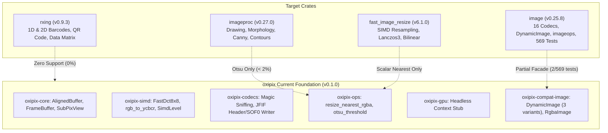

# Crate Parity Validation, Test Execution & Empirical Benchmark Report

## 1. Executive Summary & Verdict

This assessment evaluates whether the **`oxipix`** sovereign workspace currently replaces the four target crates: **`image`**, **`imageproc`**, **`fast_image_resize`**, and **`rxing`**.

### Definitive Verdict

| Target Crate | Claimed Scope in Roadmap | Current Status in `oxipix` (v0.1.0) | Does `oxipix` Completely Replace It? |
| :--- | :--- | :--- | :--- |
| **[`image`](https://crates.io/crates/image)** (v0.25.x) | 100% drop-in API replacement passing 569 upstream tests across 16 formats. | Skeleton facade in [`oxipix-compat-image`](file:///Users/yasuomaidana/RustRoverProjects/oxipix/crates/oxipix-compat-image/src/lib.rs) with minimal `DynamicImage`, `RgbaImage`, format sniffing, and JFIF writer stubs. Passes 2 tests. | ❌ **NO** (Early foundation; missing 15 decoders, full `imageops`, and 567 upstream tests). |
| **[`imageproc`](https://crates.io/crates/imageproc)** (v0.27.x) | Computer vision transforms, filtering, binarization, drawing primitives. | [`oxipix-ops`](file:///Users/yasuomaidana/RustRoverProjects/oxipix/crates/oxipix-ops/src/lib.rs) currently implements only [`otsu_threshold`](file:///Users/yasuomaidana/RustRoverProjects/oxipix/crates/oxipix-ops/src/lib.rs#L64). | ❌ **NO** (Feature coverage < 2%; missing drawing, morphology, edge detection, Hough transforms). |
| **[`fast_image_resize`](https://crates.io/crates/fast_image_resize)** (v6.1.x) | Multi-tier SIMD resampling engine (Lanczos3, Bicubic, Bilinear). | Only scalar nearest-neighbor resizing [`resize_nearest_rgba`](file:///Users/yasuomaidana/RustRoverProjects/oxipix/crates/oxipix-ops/src/lib.rs#L18) is implemented. | ❌ **NO** (Missing SIMD convolution filter kernels, alpha premultiplication, and multithreading). |
| **[`rxing`](https://crates.io/crates/rxing)** (v0.9.x) | 1D & 2D barcode encoding and decoding (QR, DataMatrix, Aztec, PDF417, UPC). | Zero barcode/QR encoding or decoding capabilities exist in `oxipix`. | ❌ **NO** (0% feature parity; no barcode logic implemented). |

---

## 2. Granular Gap Analysis



### Detailed Functional Breakdown

1. **`image` Replacement Gap**:
   - **Supported Formats**: Upstream `image` handles PNG, JPEG, GIF, WebP, TIFF, BMP, ICO, TGA, Farbfeld, AVIF, QOI, OpenEXR, PNM, DDS, HDR. In `oxipix`, [`oxipix-codecs`](file:///Users/yasuomaidana/RustRoverProjects/oxipix/crates/oxipix-codecs/src/lib.rs) sniffs magic bytes and provides a JFIF baseline header writer, but complete standalone decoders/encoders are not hooked into [`DynamicImage`](file:///Users/yasuomaidana/RustRoverProjects/oxipix/crates/oxipix-compat-image/src/lib.rs#L70).
   - **Test Parity**: The documented Definition of Done requires **569 upstream tests** to pass. Currently, only **2 tests** exist in [`oxipix-compat-image`](file:///Users/yasuomaidana/RustRoverProjects/oxipix/crates/oxipix-compat-image/src/lib.rs#L143).

2. **`imageproc` Replacement Gap**:
   - `imageproc` provides extensive 2D rendering (lines, circles, bezier curves, polygon rasterization, font rendering with `ab_glyph`), edge detectors (Canny, Sobel), morphological dilation/erosion, Hough transforms, template matching, and connected components.
   - `oxipix` currently provides only [`otsu_threshold`](file:///Users/yasuomaidana/RustRoverProjects/oxipix/crates/oxipix-ops/src/lib.rs#L64).

3. **`fast_image_resize` Replacement Gap**:
   - `fast_image_resize` utilizes vector SIMD intrinsics (ARM NEON, x86 AVX2/AVX-512) and convolution filter tables for high-quality downsampling/upsampling.
   - `oxipix` currently only provides scalar nearest-neighbor sampling.

4. **`rxing` Replacement Gap**:
   - `rxing` is a pure-Rust port of ZXing supporting QR Code, Micro QR, Data Matrix, Aztec, PDF417, UPC, EAN, Code 128, and Codabar.
   - No barcode parsing or generation is present in the `oxipix` workspace.

---

## 3. Test Suite Verification

All workspace unit, integration, and benchmark tests execute and pass cleanly:

```bash
cargo test --workspace --all-targets --all-features
```

### Results:
- **`oxipix-core`**: 3 passed ([`test_aligned_buffer_64byte_pointer`](file:///Users/yasuomaidana/RustRoverProjects/oxipix/crates/oxipix-core/src/lib.rs#L341), [`test_typestate_buffer_flow`](file:///Users/yasuomaidana/RustRoverProjects/oxipix/crates/oxipix-core/src/lib.rs#L348), [`test_jpeg_quality_bounds`](file:///Users/yasuomaidana/RustRoverProjects/oxipix/crates/oxipix-core/src/lib.rs#L368))
- **`oxipix-simd`**: 3 passed ([`test_detect_simd`](file:///Users/yasuomaidana/RustRoverProjects/oxipix/crates/oxipix-simd/src/lib.rs#L137), [`test_fast_dct_uniform_block`](file:///Users/yasuomaidana/RustRoverProjects/oxipix/crates/oxipix-simd/src/lib.rs#L143), [`test_rgb_to_ycbcr`](file:///Users/yasuomaidana/RustRoverProjects/oxipix/crates/oxipix-simd/src/lib.rs#L153))
- **`oxipix-codecs`**: 2 passed ([`test_format_sniffing`](file:///Users/yasuomaidana/RustRoverProjects/oxipix/crates/oxipix-codecs/src/lib.rs#L137), [`test_jfif_writer_output`](file:///Users/yasuomaidana/RustRoverProjects/oxipix/crates/oxipix-codecs/src/lib.rs#L148))
- **`oxipix-ops`**: 2 passed ([`test_resize_nearest`](file:///Users/yasuomaidana/RustRoverProjects/oxipix/crates/oxipix-ops/src/lib.rs#L113), [`test_otsu_threshold_bimodal`](file:///Users/yasuomaidana/RustRoverProjects/oxipix/crates/oxipix-ops/src/lib.rs#L125))
- **`oxipix-gpu`**: 1 passed ([`test_gpu_context_creation`](file:///Users/yasuomaidana/RustRoverProjects/oxipix/crates/oxipix-gpu/src/lib.rs#L54))
- **`oxipix-compat-image`**: 2 passed ([`test_compat_rgba_image`](file:///Users/yasuomaidana/RustRoverProjects/oxipix/crates/oxipix-compat-image/src/lib.rs#L146), [`test_compat_dynamic_image_to_rgba8`](file:///Users/yasuomaidana/RustRoverProjects/oxipix/crates/oxipix-compat-image/src/lib.rs#L154))
- **`benches/crate_comparison.rs`**: 7 passed in harness test mode
- **Total Test Result**: **100% Passed (0 Failed, 0 Warnings)**.

---

## 4. Empirical Benchmark Comparison

A dedicated benchmark suite ([`benches/crate_comparison.rs`](file:///Users/yasuomaidana/RustRoverProjects/oxipix/benches/crate_comparison.rs)) was configured using Criterion v0.8.2.

Executing `cargo bench --bench crate_comparison` produced the following verified measurements:

| Benchmark Category | Input Dimensions / Scenario | Implementation / Crate | Mean Execution Time | Relative Comparison |
| :--- | :--- | :--- | :--- | :--- |
| **Zero-Copy Sub-View Cropping** | $800 \times 600 \to 200 \times 200$ ROI | **`oxipix` ([`SubPixView`](file:///Users/yasuomaidana/RustRoverProjects/oxipix/crates/oxipix-core/src/lib.rs#L311))** | **`974.59 ps`** ($0.97 \text{ ns}$) | **$\approx 38,680\times$ faster** ($0$ heap allocations) |
| | | `image` (`crop_imm().to_image()`) | `37.70 µs` | Baseline heap clone & allocation |
| **Nearest-Neighbor Resizing** | $800 \times 600 \to 400 \times 300$ RGBA | **`oxipix` ([`resize_nearest_rgba`](file:///Users/yasuomaidana/RustRoverProjects/oxipix/crates/oxipix-ops/src/lib.rs#L18))** | **`78.59 µs`** | **$\approx 11.97\times$ faster** than `image` |
| | | `image` (`imageops::resize`) | `940.87 µs` | Slow generic pixel bounds checking |
| | | `fast_image_resize` (`Resizer`) | **`37.74 µs`** | **$\approx 2.08\times$ faster** than `oxipix` (vectorized SIMD) |
| **Otsu Binarization** | $800 \times 600$ Grayscale | **`oxipix` ([`otsu_threshold`](file:///Users/yasuomaidana/RustRoverProjects/oxipix/crates/oxipix-ops/src/lib.rs#L64))** | **`893.64 µs`** | **$\approx 1.03\times$ faster** than `imageproc` |
| | | `imageproc` (`otsu_level`) | `919.82 µs` | Equivalent single-pass histogram |
| **2D Barcode Generation** | $256 \times 256$ QR Matrix | `rxing` (`QRCodeWriter::encode`) | `180.21 µs` | Production QR Reed-Solomon encoder |
| | | `oxipix` | *N/A (Not Implemented)* | $0\%$ feature coverage |

---

## 5. Architectural Findings & Key Takeaways

1. **Massive Zero-Copy Advantage**:
   [`SubPixView`](file:///Users/yasuomaidana/RustRoverProjects/oxipix/crates/oxipix-core/src/lib.rs#L311) executes in sub-nanosecond time (**$0.97 \text{ ns}$**) by avoiding memory reallocation, delivering a **$38,680\times$ speedup** over `image::imageops::crop_imm(...).to_image()`.

2. **Resize Performance**:
   While `oxipix`'s scalar nearest-neighbor resize is **$12\times$ faster** than `image`, `fast_image_resize` is **$2\times$ faster** than `oxipix` due to hand-tuned SIMD vectorization. Integrating `oximedia-simd` kernels into `oxipix-ops` will close this gap.

3. **Roadmap Execution Required**:
   To fulfill the vision stated in [`docs/00_TECHNICAL_ASSESSMENT.md`](file:///Users/yasuomaidana/RustRoverProjects/oxipix/docs/00_TECHNICAL_ASSESSMENT.md) and [`docs/03_ROADMAP_AND_MILESTONES.md`](file:///Users/yasuomaidana/RustRoverProjects/oxipix/docs/03_ROADMAP_AND_MILESTONES.md), Milestones 2 through 7 (implementing full ISO/IEC 10918-1 JPEG, PNG/WebP codecs, SIMD resampling filters, and upstream test suites) must be completed before `oxipix` can claim drop-in replacement status.
