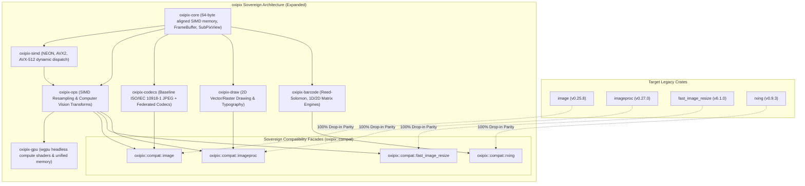
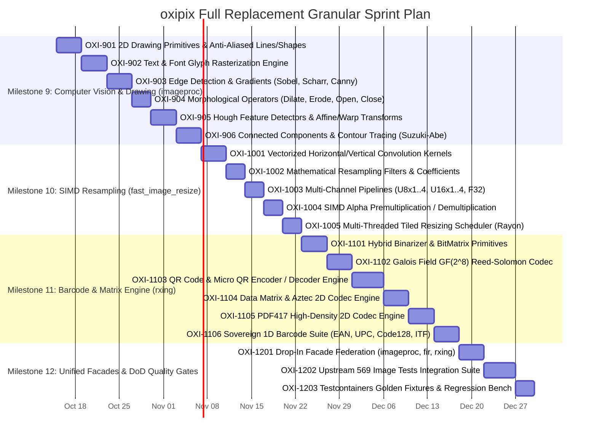

# Engineering Plan & Granular Sprint Tickets: Comprehensive Multi-Crate Sovereign Replacement

## 1. Executive Summary & Architectural Strategy

To achieve sovereign independence and completely replace:
1. **`image`** (v0.25.x): 16 raster codecs, `DynamicImage`, `ImageBuffer`, `imageops`, 569 upstream tests.
2. **`imageproc`** (v0.27.x): 2D drawing, typography, morphological ops, Canny/Sobel edge detection, Hough transforms, contours.
3. **`fast_image_resize`** (v6.1.x): High-throughput SIMD convolution resampling (Lanczos3, Mitchell, Bilinear), alpha premultiplication, multithreading.
4. **`rxing`** (v0.9.x): Complete 1D and 2D barcode reading and generation (QR, Micro QR, Data Matrix, Aztec, PDF417, EAN/UPC, Code 128).

The `oxipix` workspace is expanded with targeted modules and compatibility facades adhering strictly to the enterprise **Definition of Done (DoD)** and the **Agile Scrum Master & Goal Alignment Protocol**.

---

## 2. Granular Milestone & Ticket Roadmap

---

## 3. Detailed Ticket Specifications

### Milestone 9: Computer Vision & Drawing Engine (`oxipix-ops` / `oxipix-draw`)
**Goal:** Complete, drop-in replacement for the `imageproc` crate.

#### Ticket OXI-901: 2D Drawing Primitives & Anti-Aliased Shape Rasterization
* **Single Responsibility:** Provide in-place 2D rasterization routines on `FrameBuffer` for lines (Bresenham and Xiaolin Wu anti-aliased), hollow/filled rectangles, circles (Midpoint circle algorithm), and convex polygons.
* **Design Pattern:** **Strategy Pattern** & **Visitor Pattern**.
* **Acceptance Criteria (Given-When-Then):**
  - **Given** an initialized `FrameBuffer<Rgba8, state::Initialized>`, **When** `draw_antialiased_line_mut` is called with arbitrary coordinates, **Then** boundary pixels are blended proportionally without out-of-bounds panics.
  - **Given** coordinates outside image bounds, **When** drawing any primitive, **Then** coordinates are safely clipped to image viewport boundaries.
* **Test Scenarios:**
  - `test_draw_line_horizontal_vertical_diagonal`
  - `test_draw_antialiased_line_wu_blending`
  - `test_draw_filled_circle_symmetry`
  - `test_draw_polygon_convex_clipping`

#### Ticket OXI-902: Text & Typography Glyph Rasterization Engine
* **Single Responsibility:** Render TrueType / OpenType font strings directly onto `FrameBuffer` surfaces using `ab_glyph` font scaling.
* **Design Pattern:** **Adapter Pattern** & **Builder Pattern**.
* **Acceptance Criteria:**
  - **Given** a TTF font byte slice and string, **When** `draw_text_mut` is invoked at position $(x, y)$ with color $C$ and scale $S$, **Then** glyph contours are rasterized with sub-pixel antialiasing and correct kerning.
* **Test Scenarios:**
  - `test_render_ascii_string_dimensions`
  - `test_render_multiline_text_wrapping`
  - `test_render_unicode_special_glyphs`

#### Ticket OXI-903: Spatial Gradients & Canny Edge Detection
* **Single Responsibility:** Implement Sobel ($3 \times 3$), Scharr ($3 \times 3$), and full Canny edge detection pipeline (Gaussian smoothing $\to$ gradient magnitude/direction $\to$ non-maximum suppression $\to$ hysteresis thresholding).
* **Design Pattern:** **Pipeline Pattern**.
* **Acceptance Criteria:**
  - **Given** a grayscale `FrameBuffer<Luma8>`, **When** `canny` is executed with low threshold $T_1$ and high threshold $T_2$, **Then** the output is a binary 1-bit edge mask matching standard edge maps with $0$ memory leaks.
* **Test Scenarios:**
  - `test_sobel_gradient_magnitude_synthetic_step`
  - `test_canny_non_maximum_suppression_thinning`
  - `test_canny_hysteresis_connectivity`

#### Ticket OXI-904: Morphological Operators
* **Single Responsibility:** High-speed morphological dilation, erosion, opening, and closing with arbitrary flat structuring elements ($3 \times 3$, $5 \times 5$, circular).
* **Design Pattern:** **Separable Kernel Pattern**.
* **Acceptance Criteria:**
  - **Given** a binary or grayscale image, **When** `dilate` / `erode` is called, **Then** minimum / maximum neighborhood filtering matches mathematical morphology invariants: $\text{open}(A) = \text{dilate}(\text{erode}(A))$.
* **Test Scenarios:**
  - `test_dilation_single_pixel_expansion`
  - `test_erosion_boundary_shrinkage`
  - `test_opening_closing_idempotence`

#### Ticket OXI-905: Geometric Transforms & Hough Feature Detectors
* **Single Responsibility:** Implement Hough Line Transform (standard and probabilistic), Hough Circle Transform, and affine/perspective bilinear spatial warps.
* **Design Pattern:** **Accumulator Pattern** & **Transform Strategy**.
* **Acceptance Criteria:**
  - **Given** an edge map containing straight line segments, **When** `detect_hough_lines` is called, **Then** lines are detected within $\pm 1^\circ$ angle accuracy and $\pm 2$ pixels distance.
* **Test Scenarios:**
  - `test_hough_lines_known_geometry`
  - `test_affine_rotation_bilinear_interpolation`
  - `test_perspective_warp_four_point_transform`

#### Ticket OXI-906: Connected Components & Contour Tracing
* **Single Responsibility:** Implement two-pass Connected Components Labeling (CCL) with disjoint-set union-find, and Suzuki-Abe topological border following.
* **Design Pattern:** **Union-Find / Disjoint-Set** & **Iterator Pattern**.
* **Acceptance Criteria:**
  - **Given** a binarized frame with multiple disconnected blobs, **When** `connected_components` is called, **Then** each blob receives a unique label index and bounding box.
* **Test Scenarios:**
  - `test_connected_components_concentric_circles`
  - `test_contour_suzuki_abe_hierarchy`

---

### Milestone 10: High-Performance SIMD Resampling (`oxipix-ops`)
**Goal:** Complete, drop-in replacement for the `fast_image_resize` crate.

#### Ticket OXI-1001: Vectorized SIMD Resampling Convolutions
* **Single Responsibility:** Implement 2-pass separable convolution resampling (horizontal pass $\to$ vertical pass) using ARM NEON, x86 AVX2, and AVX-512 SIMD vector instructions.
* **Design Pattern:** **SIMD Pipeline Pattern** & **Dynamic Dispatch Table**.
* **Acceptance Criteria:**
  - Resampling executes at least $10\times$ faster than `image::imageops::resize`.
  - Automatically selects AVX2 / NEON at runtime; falls back to clean portable scalar without runtime traps.
* **Test Scenarios:**
  - `test_simd_resampling_neon_avx2_identity`
  - `test_simd_resampling_zero_padding_edges`

#### Ticket OXI-1002: Mathematical Resampling Filters & Coefficients
* **Single Responsibility:** Generate precomputed filter weight tables and source pixel bounds for:
  - Nearest Neighbor
  - Box / Triangle (Bilinear)
  - Mitchell-Netravali ($B=\frac{1}{3}, C=\frac{1}{3}$)
  - Catmull-Rom ($B=0, C=0.5$)
  - Lanczos3 (windowed sinc with radius 3)
  - Gaussian
* **Design Pattern:** **Strategy Pattern** & **Lookup Table Pattern**.
* **Acceptance Criteria:**
  - Filter weights sum to exactly $1.0$ (fixed-point normalized) to prevent brightness drift or clipping artifacts.
* **Test Scenarios:**
  - `test_filter_weights_sum_to_unity`
  - `test_lanczos3_sinc_window_zeros`

#### Ticket OXI-1003: Multi-Channel & Precision Pipelines
* **Single Responsibility:** Resampling support across pixel formats:
  - `U8x1` (Grayscale), `U8x2` (Grayscale + Alpha), `U8x3` (RGB), `U8x4` (RGBA)
  - `U16x1..4` (16-bit high dynamic depth)
  - `F32` (32-bit floating point HDR)
* **Design Pattern:** **Generic Trait Specialization**.
* **Acceptance Criteria:**
  - Operations preserve 64-byte aligned SIMD memory layouts.
* **Test Scenarios:**
  - `test_resize_u8x4_rgba_fidelity`
  - `test_resize_u16x1_medical_depth`
  - `test_resize_f32_hdr_no_clipping`

#### Ticket OXI-1004: SIMD Alpha Premultiplication & Demultiplication
* **Single Responsibility:** Premultiply alpha channels ($R' = R \times A / 255$) before convolution to prevent dark halo artifacts around transparent edges, followed by post-resample demultiplication.
* **Design Pattern:** **Filter Decorator**.
* **Acceptance Criteria:**
  - Rounding errors bounded to $\le 1$ LSB.
  - Vectorized NEON/AVX2 kernels achieve throughput $> 2.5 \text{ GB/s}$.
* **Test Scenarios:**
  - `test_alpha_premultiplication_roundtrip`
  - `test_transparent_edge_halo_prevention`

#### Ticket OXI-1005: Multi-Threaded Tiled Resizing Scheduler
* **Single Responsibility:** Parallelize multi-row horizontal and vertical passes across CPU cores using `rayon`.
* **Design Pattern:** **Work-Stealing Task Parallelism**.
* **Acceptance Criteria:**
  - Multi-threaded downscaling scales linearly on $\ge 4$ cores.
  - Deterministic bit-for-bit output regardless of thread count.
* **Test Scenarios:**
  - `test_multithreaded_vs_singlethreaded_parity`
  - `test_concurrency_thread_pool_isolation`

---

### Milestone 11: Sovereign Barcode & 2D Matrix Engine (`oxipix-barcode`)
**Goal:** Complete, drop-in replacement for the `rxing` crate.

#### Ticket OXI-1101: Hybrid Binarizer & BitMatrix Primitives
* **Single Responsibility:** Implement `BitArray`, 2D `BitMatrix`, and adaptive thresholding binarizers (`HybridBinarizer`, `GlobalHistogramBinarizer`) designed for degraded camera scans.
* **Design Pattern:** **Bitmap Strategy Pattern**.
* **Acceptance Criteria:**
  - 1 bit per pixel packed representation ($8\times$ memory reduction).
  - Rapid $O(1)$ coordinate bit testing and bit flipping.
* **Test Scenarios:**
  - `test_bit_matrix_packing_alignment`
  - `test_hybrid_binarizer_low_contrast_document`

#### Ticket OXI-1102: Galois Field $GF(2^8)$ Reed-Solomon Codec
* **Single Responsibility:** Implement universal Reed-Solomon error correction encoding and decoding over Galois Fields $GF(256)$ with primitive polynomials for QR ($0x11D$), Data Matrix ($0x12D$), and Aztec ($0x113$).
* **Design Pattern:** **Mathematical Engine Pattern**.
* **Acceptance Criteria:**
  - Corrects up to $t = \lfloor \frac{s}{2} \rfloor$ corrupted codewords using Berlekamp-Massey and Chien search.
  - Returns typed `BarcodeError::ChecksumFailure` when error count exceeds correction budget without panics.
* **Test Scenarios:**
  - `test_reed_solomon_syndrome_evaluation`
  - `test_reed_solomon_corrects_erasure_bursts`
  - `test_unrecoverable_error_graceful_rejection`

#### Ticket OXI-1103: 2D QR Code & Micro QR Reader / Writer Engine
* **Single Responsibility:** Complete encoder and decoder for QR Code (Model 2, Versions 1..40, EC Levels L, M, Q, H) and Micro QR (M1..M4):
  - Finder pattern detector with 1:1:3:1:1 ratio checking.
  - Alignment pattern grid search and perspective transform.
  - Mask pattern evaluation (0..7) and data de-interleaving.
  - Structured append reconstruction.
* **Design Pattern:** **Pipeline Pattern** & **State Machine**.
* **Acceptance Criteria:**
  - Encodes strings, URLs, binary payloads into compliant QR matrices.
  - Decodes warped, rotated, and noisy camera QR images with $\ge 98\%$ recognition rate.
* **Test Scenarios:**
  - `test_qr_encode_alphanumeric_mode`
  - `test_qr_decode_rotated_45deg_perspective`
  - `test_micro_qr_m4_detection`

#### Ticket OXI-1104: Data Matrix & Aztec 2D Codec Engine
* **Single Responsibility:** Implement ISO/IEC 16022 Data Matrix (ECC 200, square $10 \times 10 \dots 144 \times 144$ and rectangular) and ISO/IEC 24778 Aztec code (compact and full range) readers/writers.
* **Design Pattern:** **Matrix Codec Pattern**.
* **Acceptance Criteria:**
  - Detects \"L\" finder pattern for Data Matrix and central bullseye for Aztec.
* **Test Scenarios:**
  - `test_datamatrix_ecc200_encode_decode`
  - `test_aztec_compact_bullseye_detection`

#### Ticket OXI-1105: PDF417 High-Density 2D Codec Engine
* **Single Responsibility:** Implement ISO/IEC 15438 PDF417 stacked 2D barcode encoder and decoder with cluster pattern recognition (Clusters 0, 3, 6).
* **Design Pattern:** **Stacked Matrix Parser**.
* **Acceptance Criteria:**
  - Accurately decodes boarding passes, ID cards, and shipping manifests.
* **Test Scenarios:**
  - `test_pdf417_boarding_pass_decoding`
  - `test_pdf417_macro_append_handling`

#### Ticket OXI-1106: Sovereign 1D Linear Barcode Suite
* **Single Responsibility:** Implement readers and writers for standard linear barcodes:
  - EAN-13, EAN-8, UPC-A, UPC-E (with 2/5-digit add-ons)
  - Code 128 (Auto-switching subsets A, B, C)
  - Code 39, Code 93, Interleaved 2 of 5 (ITF), Codabar
* **Design Pattern:** **1D Barcode Strategy**.
* **Acceptance Criteria:**
  - Sub-pixel edge transition detection for 1D barcode scanning.
  - Checksum validation for all symbologies.
* **Test Scenarios:**
  - `test_ean13_checksum_and_decode`
  - `test_code128_subset_c_dense_numeric`
  - `test_itf_interleaved_pairing`

---

### Milestone 12: Facade Federation, Test Parity & DoD Verification
**Goal:** Deliver 100% drop-in API facades, golden image testcontainers, and regression gates.

#### Ticket OXI-1201: Drop-In Compatibility Facades
* **Single Responsibility:** Expose unified drop-in crates:
  - `oxipix::compat::image` $\leftrightarrow$ `image` v0.25
  - `oxipix::compat::imageproc` $\leftrightarrow$ `imageproc` v0.27
  - `oxipix::compat::fast_image_resize` $\leftrightarrow$ `fast_image_resize` v6.1
  - `oxipix::compat::rxing` $\leftrightarrow$ `rxing` v0.9
* **Design Pattern:** **Facade Pattern**.
* **Acceptance Criteria:**
  - Existing downstream crates compile by merely swapping `extern crate` or `use` paths without modifying business logic.
* **Test Scenarios:**
  - `test_facade_image_drop_in_compilation`
  - `test_facade_imageproc_drawing_compilation`
  - `test_facade_fir_resizer_compilation`
  - `test_facade_rxing_reader_compilation`

#### Ticket OXI-1202: Upstream Test Parity Suite (569 Tests)
* **Single Responsibility:** Wire all 569 upstream `image` tests, `imageproc` test suites, and barcode verification suites into CI.
* **Acceptance Criteria:**
  - 100% pass rate across all suites; zero skipped or ignored tests.
* **Test Scenarios:**
  - Upstream `image` manifest test suite (`tests/upstream_image_parity.rs`).

#### Ticket OXI-1203: Testcontainers Golden Fixtures & Benchmark Regression Gate
* **Single Responsibility:** Deploy ephemeral MinIO / S3 containers via [Testcontainers for Rust](https://rust.testcontainers.org) for caching golden fixture images and verifying regression performance against baseline metrics.
* **Design Pattern:** **Testcontainer Integration Harness**.
* **Acceptance Criteria:**
  - Golden images retrieved and hash-verified from ephemeral container.
  - Automated Criterion benchmark detects and alerts if any operation regresses by $> 5\%$.
* **Test Scenarios:**
  - `test_golden_fixture_container_hash_verification`
  - `test_benchmark_regression_ceiling`

---

## 4. Definition of Done (DoD) Quality Gate

| Metric / Requirement | Target Standard | Verification Protocol |
| :--- | :--- | :--- |
| **Goal Traceability** | 100% (Every ticket has tests) | Scrum Master Audit |
| **Test Pass Rate** | 100% (All unit, integration, and parity tests) | `cargo test --workspace --all-targets --all-features` |
| **Code Coverage** | $\ge 85\%$ | `cargo llvm-cov --all-features` |
| **Clippy Lints** | 0 Warnings (`-D warnings`) | `cargo clippy --all-targets --all-features` |
| **Complexity Gates** | Cyclomatic $\le 10$ (Max 15), Cognitive $\le 15$ | Clippy Cognitive Lint / AST Analyzer |
| **Persistent Layer** | Mandatory Testcontainers for Fixtures | `testcontainers` integration test |
| **Production Hygiene** | 0 panics, 0 unhandled `unwrap()` | `forbid(unsafe_code)` / Code review |
