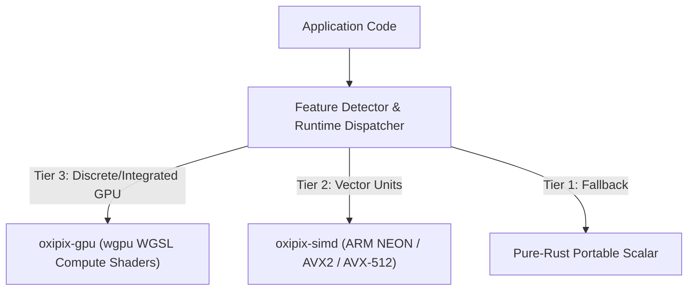

# Hardware Acceleration: SIMD & GPU Compute

`oxipix` incorporates a 3-tier execution model designed to leverage the highest performance hardware available on the host machine:



---

## 1. Dynamic Runtime CPU Feature Detection

Rather than requiring target-cpu compile flags (which break binary portability across diverse machines), `oxipix-simd` detects hardware capabilities at runtime:

```rust
use oxipix::simd::SimdFeatureDetector;

fn main() {
    let detector = SimdFeatureDetector::detect();
    println!("Detected CPU Features:");
    println!("  - ARM NEON: {}", detector.has_neon());
    println!("  - x86 AVX2: {}", detector.has_avx2());
    println!("  - x86 AVX-512: {}", detector.has_avx512());
    println!("  - Optimal Vector Width: {} bytes", detector.optimal_vector_width());
}
```

---

## 2. GPU Compute Pipelines (`oxipix-gpu`)

For large 4K/8K images or batch inference preprocessing, `oxipix-gpu` executes raster operations directly in GPU VRAM using `wgpu`:

```rust
use oxipix::gpu::GpuContext;

#[tokio::main]
async fn main() -> Result<(), oxipix::OxipixError> {
    // 1. Initialize GPU compute device and command queue
    let ctx = GpuContext::init().await?;
    println!("Initialized GPU Adapter: {}", ctx.adapter_name());

    // 2. Upload raw pixels directly into unified memory buffer
    let input_bytes = vec![128u8; 3840 * 2160 * 4];
    let gpu_buffer = ctx.create_pixel_buffer(&input_bytes)?;

    // 3. Dispatch parallel compute shader (e.g. Gaussian blur or box filter)
    let output_buffer = ctx.dispatch_filter(&gpu_buffer, 3840, 2160)?;

    // 4. Map back to CPU memory
    let result = output_buffer.read_bytes().await?;
    assert_eq!(result.len(), 3840 * 2160 * 4);

    Ok(())
}
```
