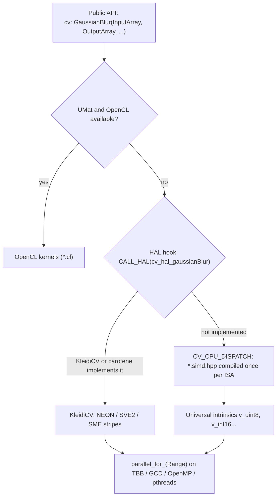

# 04: Architecture for OpenCV-class kernels in oxipix

| | |
|---|---|
| Status | **Proposed.** It takes effect only if [ADR-0005](../../adr/0005-opencv-parity-scope.md) is accepted. Revision 2: revised after the EGM review in [05](05_EGM_REVIEW.md) (102 findings; the resolution of each is recorded there). |
| Builds on | oxipix `imgproc` (OXI-94, OXI-95 and OXI-96, merged as PRs #5 and #6 on 2026-11-27); the `parallel` feature (OXI-97, open as PR #8); `gpu` (0.1.0); ADR-0001; ADR-0003 |
| Scope | The modules that [03](03_UPSTREAM_VS_NEW.md) §2 marks "Build": imgproc (including features), photo, video background subtraction, plus the parallel and GPU layers. `mosaic` and `vectorize` (stitching and tracing) are unchanged. Adapters are listed in 03 and not designed here. |

Terms used below:

| Term | Meaning |
|---|---|
| **Stripe** | A contiguous range of output rows processed as one unit of work. OXI-97 calls these "bands". |
| **HAL** | OpenCV's Hardware Acceleration Layer: plug-in libraries that OpenCV calls first for an operation. KleidiCV is Arm's library; carotene is the NEON library bundled with OpenCV. |
| **T-API / `UMat`** | OpenCV's Transparent API: `UMat` arrays run on OpenCL when it is available. |
| **REA** | Reverse-engineering analysis with the `dendrite retro` tool: index an upstream source tree, then search it to describe algorithms without copying code (§10). |
| **EGM** | The Elephant-Goldfish Model: the author drafts with full context, then reviewers with no context review the draft (05). |
| **Reference kernel** | The plain scalar implementation of an operation that every faster variant is tested against. |
| **Probe** | The benchmark-harness code that runs one operation on one library. |

## 1. Goals and non-goals

1. **G1, speed.** For each operation, oxipix's median time is at most 1.5x OpenCV 5.1's, single-threaded, using the
   [rust-cv-guide](https://github.com/yasuomaidana/rust-cv-guide) fixtures at the small, medium (1920 px wide) and large
   (3840 px wide) sizes, with a matching output (§9). Each platform is compared with its own OpenCV build:
   - aarch64 against OpenCV with KleidiCV;
   - x86_64 against OpenCV with its AVX2 dispatch (not measured yet).

   The gating number comes from the **default release profile**: no `target-cpu=native`, no fat LTO. The `native`
   number is reported alongside. An operation that cannot meet G1 gets a recorded decision instead: delegate it (to
   kornia-rs, for example) or freeze it ([03](03_UPSTREAM_VS_NEW.md) §4).
2. **G2, opt-in everything.** The default build is pure Rust, with no threads, no GPU and no FFI, and compiles for
   `wasm32-unknown-unknown`, iOS and Android. The default features `imgproc`, `vectorize` and `mosaic` already compile
   for wasm32 (checked, [01](01_LANDSCAPE.md) §3). Threads, GPU and each module are cargo features. CI checks all of
   this from phase 0 on.
3. **G3, one specification per operation.** The reference kernel defines the result. The production body, any
   explicit-SIMD body and the WGSL twin are tested against it. Today `gpu::cpu` and `imgproc` disagree on warp borders
   and rounding (§7.1). That is resolved before any GPU twin is added.
4. **G4, less repeated code, stated honestly.** An operation has one production body and one reference. Optional
   extras are an explicit-SIMD body and a WGSL twin, and only where a measurement justifies them. The repeated plumbing
   is generated: channel-count dispatch, stripe splitting, borders and the standard tests.
5. **G5, measured claims.** An operation is called "at parity" only after the golden-output gate and the performance
   gate in §9 both pass.

Non-goals: an inference engine, codecs, video I/O, a GUI, our own owning matrix type, `cv::` name compatibility,
OpenCL, and a runtime backend switch (§8).

## 2. Reference architectures

### 2.1 OpenCV 5.1 (from the source and the `ocv51-*` REA analyses)



What carries over:
- several implementations of one operation, chosen by the CPU's capabilities;
- parallelism over row ranges;
- one vector source compiled for several ISAs.

What does not carry over: `InputArray` type erasure, OpenCL/T-API (wgpu takes its place), and the monolithic build.

### 2.2 KleidiCV

KleidiCV is a C API of about 40 operation families. Many of them have explicit `*_stripe` entry points, and a separate
`kleidicv_thread` layer schedules the stripes. The model worth copying is a narrow kernel layer plus a separate
scheduler. KleidiCV still keeps some operations whole (for example `canny` and `min_max_loc`), because not every
operation can be split into stripes (§6).

## 3. Crate layout: staged, not split up front

The request allows sub-crates. The review showed that cargo features already give "users of one module do not compile
the others" (G2), and that each crate adds release and gate overhead: a README, a CHANGELOG, a publish order and its own
coverage. So the split is staged, and each stage has a trigger.

| Stage | Crates | Trigger |
|---|---|---|
| 1 (phase 1) | `oxipix` (unchanged modules) and **`oxipix-macros`** (proc-macro crates must be separate) | The first proc macro lands (§5.3) |
| 2 | Add **`oxipix-core`** (`View`, `Border`, `Stripe`, the scheduler, `luma`, and one Otsu shared by `vectorize` and `imgproc`) | A second crate needs these types, or a proc macro needs stable absolute paths |
| 3 | Move modules out (`oxipix-imgproc`, `oxipix-photo`, `oxipix-video`, `oxipix-gpu`, `oxipix-mosaic`, `oxipix-vectorize`); `oxipix` becomes a facade with one feature per module | A measured trigger: a module's clean build exceeds a budget, or a consumer needs one module without the others' dependencies |

Release policy (needed from stage 1): lockstep versions; publish order macros, then core, then modules, then the facade;
the CI `package` job runs `cargo publish --dry-run` for each crate in that order. Public paths such as
`oxipix::imgproc::filter::blur::gaussian_blur` and `oxipix::gpu::GpuImageExt` stay the same; a compile test checks
them. ADR-0005 supersedes ADR-0001's "one crate" consequence and records this policy. FAST and BRIEF stay in
`imgproc::detect::features` (ORB would be new code).

Dependency direction at stage 3: `imgproc`, `photo` and `video` depend on `core`. `photo` and `video` also depend on
`imgproc`. `mosaic` depends on `core` (for `luma`) and, with its `gpu` feature, on `gpu`; it does not use `imgproc`.
`vectorize` depends on `core`. `gpu` depends on `core`.

Quality gates for each crate ([02_QUALITY_GATES.md](../../02_QUALITY_GATES.md)): a README and CHANGELOG for each
package, at most 12 files per directory, 500 lines per file, the complexity limits and zero duplication. Coverage is
100% for default features. Phase 1 adds a coverage job with `parallel` on and a coverage job on aarch64. GPU code is
covered by the software-adapter job (§9).

## 4. Core types

```rust
/// Borrowed image: `C` interleaved channels of `T`. `stride` is in samples (not bytes) and is at least `width * C`;
/// `data.len() >= stride * (height - 1) + width * C`. `Copy`, `Send` and `Sync` when `T` is.
pub struct View<'a, T, const C: usize> { data: &'a [T], width: usize, height: usize, stride: usize }
pub struct ViewMut<'a, T, const C: usize> { /* same fields over &'a mut [T]; Send, not Copy */ }

impl<'a, T, const C: usize> View<'a, T, C> {
    pub fn new(data: &'a [T], width: usize, height: usize, stride: usize) -> Result<Self, ViewError>;
    pub fn roi(&self, x: usize, y: usize, w: usize, h: usize) -> Option<View<'a, T, C>>; // no copy
    pub fn row(&self, y: usize) -> &'a [T];                                               // width * C samples
}
impl<'a, T, const C: usize> ViewMut<'a, T, C> {
    /// Disjoint row ranges, so stripes can run in parallel without `unsafe`.
    pub fn split_rows(self, stripes: &[Stripe]) -> impl Iterator<Item = (Stripe, ViewMut<'a, T, C>)>;
}

pub enum ViewError { StrideTooSmall, BufferTooShort, ZeroSize }
pub enum Border<T, const C: usize> { Replicate, Reflect101, Constant([T; C]), Transparent /* warps */ }
pub struct Stripe { pub start: usize, pub end: usize } // output rows [start, end)
```

- **Owning buffers stay `image::ImageBuffer`** (ADR-0001), and `image` stays a required dependency. Existing functions
  keep their signatures **and their behaviour**: replicated borders, and the imageproc radius rule
  (`ceil(2 * sigma)`). The module documentation promises the same results as imageproc (`src/imgproc/mod.rs:3-5`).
- **OpenCV behaviour is opt-in.** New `*_into(src: View, dst: ViewMut, border: Border, ...) -> Result<(), ViewError>`
  forms take an explicit `Border`, and use OpenCV's kernel-size rule where it differs. Switching the defaults of the
  existing functions to OpenCV's (`Reflect101`) would be a breaking change. It is not planned. If it is ever made, it
  needs a minor version bump, a CHANGELOG entry and re-recorded characterization hashes.
- **Morphology** uses `Constant` with the neutral element (+inf for erode, -inf for dilate), which matches OpenCV's
  `morphologyDefaultBorderValue`. `Reflect101` on an image smaller than the kernel radius falls back to `Replicate`,
  and the documentation says so.
- **From `P: Pixel` to `const C`:** a sealed trait `Channels` maps `Luma`, `LumaA`, `Rgb` and `Rgba` to 1, 2, 3 and 4.
  `P::CHANNEL_COUNT` cannot be a const generic argument on stable Rust. Every channel count `image` supports is covered,
  so `LumaA` keeps working.
- **Interop:** `From<&ImageBuffer>` only. `kornia` and `ndarray` view conversions wait until a consumer asks
  (finding Z9).

## 5. Kernels and macros

### 5.1 The repeated patterns in today's code (`main` @ 412b476)

| Shape | Where | Note |
|---|---|---|
| Per-channel planes | `median` (splits the channels with `step_by`, `filter/median.rs:113-130`), `mosaic::luma::map_channels` (`mosaic/luma.rs:13-26`), `mosaic::perspective::warp_cpu` (`mosaic/perspective.rs:96-107`) | `map_channels` takes `&mut dyn FnMut` on purpose, so there is one instance for per-binary coverage |
| Interleaved row kernels with stride `P::CHANNEL_COUNT` | `blur`, `pyramid`, `warp`, `filter2d`, `bilateral` (whose colour weight sums across channels, so it cannot be split per channel) | Already monomorphised per `P` |
| Separable passes on bordered rows | `blur` (u16 accumulate, u8 intermediate), `gradient`, `pyramid` (vertical pass first) through `rows::{accumulate, pad_row, clamp_row}`; `morph` (neutral padding, O(log n) min/max doubling on u8, column pass over the whole plane); a private f32 11-tap blur in `color/quality.rs:50` | `rows.rs` is the shared base |
| Generated tables | `generated/median_networks.rs` (a `macro_rules!` network) | Precedent for generated kernels |
| Test and benchmark scaffolding | `testing::noise` in `imgproc/mod.rs`, `tests/common/mod.rs` (`Golden`, `fnv`, `hash_image`), the hand-registered criterion bench (which repeats `noise`) | Extend these, do not replace them |

### 5.2 Stage A: declarative helpers (phase 1)

These are `macro_rules!` helpers, so no proc-macro crate needs to be built for them:

- `per_channel!(kernel, src, dst)`: built on `map_channels` (keeping its `dyn` design), used by median and the mosaic
  warp.
- `separable!(h_pass, v_pass, acc = u16 | i16 | f32)`: built on `rows::*`; used by blur, gradient, pyramid and the
  SSIM blur, which is then shared instead of private.
- `channels_dispatch!(P, |C| body)`: the sealed-trait match from §4.

### 5.3 Stage B: `#[kernel]` (after a prototype)

The request asks for proc macros. A proc macro earns its place only when it generates something `macro_rules!` cannot:
the stripe wrapper with a scratch arena, the dispatch over constant channel counts, and the reference tests. Before
phase 1 ends, one kernel (`box_blur`) is converted with a prototype, and its llvm-cov line coverage is recorded. If the
generated code cannot reach the coverage gate, stage B is dropped and stage A stays.

```rust
#[oxipix_macros::kernel(
    channels = [1, 2, 3, 4],     // instances; the facade dispatches through `Channels` (§4)
    shape = row_local,           // row_local | map_reduce(merge = fn) | whole (§6)
    halo = 2,                    // input rows each stripe needs above and below its output
    reference = box_blur_ref,    // fn(View<u8, C>, ViewMut<u8, C>, &Params)
    tolerance = 0,               // max absolute difference against the reference (0 = exact)
    crate = ::oxipix_core,       // path override, as serde does
)]
fn box_blur<const C: usize>(src: View<u8, C>, dst: ViewMut<u8, C>, scratch: &mut Scratch, p: &Params) { /* body */ }
```

What it generates:
- `box_blur_stripe`, which runs the kernel on one stripe;
- a `#[cfg(test)]` module that checks every instance against the reference with a fixed seed (the existing `noise`
  helper), plus borders, an empty image and every channel count.

What it does not generate:
- ISA clones. Where x86 dispatch is needed, use the `multiversion` crate.
- Benchmark registration. `comparisons/opencv` keeps a hand-written list (ADR-0003 separation).
- GPU registration (§7).

The macro's logic lives in a `proc_macro2`-only module, covered by unit tests and expansion snapshots
(`macrotest`/`trybuild`).

### 5.4 Explicit SIMD

The spike shows that safe code the compiler auto-vectorises beats KleidiCV on separable filters
([02](02_GAP_ROOT_CAUSES.md) §4). An explicit `wide` body is written for a kernel only after a measurement shows the
auto-vectorised body cannot meet G1 (the candidates are median, FAST and erode). It must pass the same reference tests.
Every helper a kernel calls is `#[inline]` or generic, so the compiler can inline it into an ISA clone when the crate
is built without fat LTO.

## 6. Parallel layer

Not every operation splits into independent stripes. Each operation is classified into one of three shapes:

| Shape | Contract | Operations |
|---|---|---|
| `row_local` | `fn(src, dst_stripe, stripe, scratch)`: each stripe reads its rows plus `halo` rows of input | box, Gaussian, `filter2D`, Sobel/Laplacian, median, bilateral, morphology, pyrDown (with output rows mapped 2:1), warps (the whole source is readable), `addWeighted`, `convertTo`, threshold, `inRange` |
| `map_reduce` | each stripe returns a partial result, and `merge` combines them | histograms (`equalizeHist`, Otsu), Hough accumulators, PSNR/SSIM sums, FAST candidates plus a serial non-maximum suppression across seams |
| `whole` | serial, or a parallel phase plus a serial fix-up | Canny (gradient and NMS stripes, then serial hysteresis), distance transform (two raster passes), contours, FFT template matching (parallel over FFT tiles at most) |

- `par::run(rows, work_per_row, op)`. Here `work_per_row` is width times taps. It runs serially when `parallel` is off,
  or when `rows * work_per_row` is below the operation's `min_work`. Phase 2 measures `min_work` and records it as a
  constant next to the kernel. One unit throughout: pixel-taps.
- Stripe height is at least `4 * halo` rows. Separable kernels recompute the horizontal pass for their halo rows,
  because sharing it across stripes would need synchronisation. Each worker keeps its own `Scratch` arena, reused
  across calls, which removes the per-call allocations seen in `morph` (`filter/morph.rs:63-85`).
- There is no nested-parallelism guard. Rayon handles nesting, and the layer respects `ThreadPool::install`, so callers
  choose the pool and the thread count. Benchmarks report 4 threads (the M3's performance cores) and 8.
- `wasm-threads` (`wasm-bindgen-rayon`) is deferred. It needs nightly, `-Z build-std` and `+atomics`, which is outside
  the MSRV gate. Until then wasm builds run serially.

## 7. GPU layer (wgpu)

### 7.1 Before adding anything: one specification

There are three perspective-warp specifications today:
- `gpu::cpu`: white border, truncation (`gpu/cpu.rs:59, 82`);
- `imgproc::warp`: constant 0 border, rounding (`geometry/warp.rs:3-4, 29`);
- `mosaic`'s CPU warp: edge clamp, through oximedia-cv.

The 3x3 filter also differs (`gpu::cpu` truncates, `filter2d` rounds). Phase 3 starts by making the `imgproc` kernel
the reference, with an explicit `Border`, and widening RM-WARP (OXI-86) to cover all three warps. The 0.1.0 WGSL kernels
are then changed to match the reference. They are not reused unchanged.

### 7.2 Context and API (fixes the wasm build)

```rust
impl GpuContext {
    pub async fn new(opts: GpuOptions) -> Result<Self, GpuError>;        // all targets
    #[cfg(not(target_arch = "wasm32"))] pub fn new_blocking(opts: GpuOptions) -> Result<Self, GpuError>;
    pub fn set_global(ctx: GpuContext);                                   // wasm has no lazy creation
}
impl GpuImage {                                                           // resident buffer, owned by an Arc<GpuContext>
    pub fn upload(ctx: &Arc<GpuContext>, image: &RgbaImage) -> Result<Self, GpuError>;
    pub async fn download(&self) -> Result<RgbaImage, GpuError>;         // map_async; never blocks the browser
    #[cfg(not(target_arch = "wasm32"))] pub fn download_blocking(&self) -> Result<RgbaImage, GpuError>;
}
```

- `GpuImageExt` keeps its synchronous signatures on native targets only (`#[cfg(not(target_arch = "wasm32"))]`). Today's
  `GpuContext::global()` stays on native. On wasm, `set_global` uses a `thread_local!`, or wgpu's
  `fragile-send-sync-non-atomic-wasm` feature.
- Storage layout: packed `u32` storage buffers. RGBA uses one u32 per pixel. Gray packs four pixels per u32, with rows
  padded to 4 pixels. RGB is unpacked to RGBA on upload; that cost is measured and reported.
- Buffers and bind groups come from per-context pools instead of being created on every call (`gpu/context.rs:169-218`).
- A device lost in the middle of a call returns `GpuError::DeviceLost`. Falling back to the CPU stays the job of the
  `GpuImageExt` convenience layer, not of `GpuContext`.

### 7.3 Pipelines and more kernels: only after a measurement

A `GpuPipeline` (operations recorded into one command buffer, with one upload and one readback) and further WGSL twins
are added only after OXI-98 measures that upload and readback dominate at medium and large sizes. If they are built,
the operation trait lives in `gpu`, and `imgproc` implements it for its operations (no dependency cycle). cubecl
(`#[cube]` Rust kernels compiled to wgpu) is a watch item, not a planned step.

## 8. No runtime backend switch

The first draft had a "light HAL" that could quietly route an operation to kornia-rs when kornia is faster. It is
removed:
- Cargo feature unification would let any crate in the dependency tree change oxipix's numeric output.
- kornia pulls in rayon, which breaks G2.
- kornia does not build for wasm.
- "Faster" was measured on one machine.

The path is chosen by the caller's type, as today: `GpuImage`/`GpuImageExt` against `ImageBuffer`. Callers who want
kornia call kornia directly. "Delegate this operation to kornia" stays a planning decision ([03](03_UPSTREAM_VS_NEW.md)
§4), not runtime machinery.

## 9. Conformance and performance gates

| Gate | Where | What |
|---|---|---|
| Reference tests | each crate, default CI | Each variant against the reference: exact for integer kernels, or within the kernel's stated `tolerance` |
| OpenCV golden outputs | extend `tests/common/mod.rs` (`Golden`) and the characterization tests | Small fixtures (at most 64 KB each, licences in `ATTRIBUTION.md`) are run through OpenCV once by `comparisons/opencv`. The committed result is an exact hash for bit-exact operations. For the others, it is the OpenCV output PNG with a per-operation maximum absolute difference and a maximum count of differing pixels. Each golden file records the OpenCV version, the HAL (KleidiCV, carotene or none) and the architecture. Regenerating them is one command in `comparisons/opencv`. |
| Performance | `comparisons/opencv`: manual, plus a weekly scheduled run | Small, medium and large fixtures; 1, 4 and 8 threads; the default release profile (gating) and `native` (reported). The ratio is the oxipix median divided by the OpenCV median, using the harness rule (at least 200 ms of samples, median and MAD). It counts as a difference only when it exceeds 5% and twice the relative MAD. The parity badge needs a passing golden check, not only the mean digest. The reference machine is an Apple M3 for aarch64; an x86_64 AVX2 machine is still to be chosen. |
| GPU parity | CI job with a software adapter (Mesa lavapipe) | Generated GPU tests call `GpuContext` directly, fail on `GpuError`, print the adapter name, and report "skipped" when there is no adapter, instead of falling back to the CPU and passing |
| Platforms | CI matrix (phase 0) | `cargo check` for `wasm32-unknown-unknown` (default features, plus `gpu` from phase 3), `aarch64-apple-ios` and `aarch64-linux-android`; `cargo test` on x86_64 (AVX2) and on `ubuntu-24.04-arm` |
| Build time | CI | A clean build of the default features stays within 120% of 0.1.0's |

## 10. REA process and licence

OpenCV and KleidiCV are Apache-2.0. Code copied from them would make the copied files Apache-2.0 only, which breaks
oxipix's "MIT OR Apache-2.0". So kernels are written clean-room:

1. **Analyse:** use REA to find the operation's algorithm, special cases, borders and rounding, and the papers it is
   based on.
2. **Write the note:** `docs/rea/<operation>.md` describes the behaviour and the algorithm in prose, cites papers and
   OpenCV file paths, and contains no code. Constant tables (sorting networks, fixed-point weights) are generated by
   our own script, as `median_networks.rs` is.
3. **Implement from the note.** This must be a separate session that has the note and the papers but no access to the
   OpenCV source or its REA index. The PR records the session and what it had access to.
4. **Check:** the golden outputs prove the behaviour, and the PR review compares the code's structure with the note,
   not with OpenCV.

The `dendrite retro` command lines are part of the `docs/rea/README.md` process note, which phase 1 adds.

## 11. Comparison

| Aspect | OpenCV 5.1 | KleidiCV | kornia-rs | This proposal |
|---|---|---|---|---|
| Container | `Mat`/`UMat` (type-erased) | raw pointer and stride | `Image<T, C>` (owned, contiguous) | `image::ImageBuffer` (owned), plus `View`/`ViewMut` (strided, ROI) |
| ISA variants | universal intrinsics plus `*.simd.hpp` | per-ISA files from shared templates | `wide`, NEON | one auto-vectorised safe body; `wide` body where measured; `multiversion` for x86 |
| Parallel | `parallel_for_` | `kleidicv_thread` stripes | rayon inside each op, always on | opt-in `parallel`; row_local, map_reduce and whole shapes; per-op `min_work` |
| GPU | OpenCL T-API; CUDA in contrib | – | CUDA | wgpu, resident `GpuImage`, async readback; pipelines when measured |
| wasm | opencv.js (Emscripten) | – | build fails | first-class target, checked in CI |
| Backend choice | HAL hooks at run time | is a HAL | – | the caller's type; no runtime switch |
| Repetition control | C++ templates and macros | shared templates | generics | `macro_rules!` helpers; `#[kernel]` if the prototype passes the gates |
| Parity evidence | its own test data | conformity suite | OpenCV fixture scripts | golden outputs from a pinned OpenCV build, plus a performance gate on three sizes |

## 12. Phases

| Phase | Content | Exit criterion |
|---|---|---|
| 0 | Land OXI-97 and OXI-98. Fix the probes in `comparisons/opencv`: the distance transform runs `DIST_MASK_PRECISE` on the OpenCV side; Canny uses `gaussian_blur_radius(1.4, 4)` and OpenCV's border; Hough records circle counts; the homography points and circle radii scale with the fixture size. Add the platform CI matrix. | Both sides report the same parameters for every probe; the matrix is green |
| 1 | PR 1: `macro_rules!` helpers on the existing kernels (no behaviour change). PR 2: `View`, `Border` and `Stripe`, plus `*_into` for box, Gaussian, median and erode. PR 3: the `#[kernel]` prototype on `box_blur`, with its coverage result. Then crate stage 1. | Characterization hashes unchanged; the criterion medians of the named benches are not more than 5% slower; the coverage gate passes |
| 2 | Close the gaps, worst first, with the causes from [02](02_GAP_ROOT_CAUSES.md) §3: median (a smaller network, reused column sorts, fewer copies), FAST (16 lanes), bilateral, the warps (fixed-point coordinates), the morphology and pyrDown allocations; measure `min_work` for each operation | Each operation meets G1 at all three sizes, **or** has a recorded decision to delegate or freeze it |
| 3 (can run alongside 2) | One warp and filter specification (§7.1); explicit and async `GpuContext`; resident `GpuImage`; the wasm `gpu` build; the lavapipe CI job | `gpu` builds for wasm32; GPU parity tests run on CI |
| 4 | `photo` for RM-ENHANCE (OXI-85): CLAHE, background division, denoising, after checking what imageproc provides. Video background subtraction only once a ticket with a consumer exists. | Golden outputs pass |
| 5 | Adapters (codecs, dnn, videoio) as optional features | Examples in rust-cv-guide |

## 13. Risks

- **Scope creep toward "all of OpenCV".** A module enters only with a ticket and a consumer (03 §4).
- **kornia-rs catches up.** Acceptable: the operation is delegated, and the parts only oxipix has remain (wgpu, wasm,
  opt-in threads).
- **The proc macro does not pay off.** It is gated by the phase-1 prototype; the fallback is the `macro_rules!` helpers.
- **The generated instances break the coverage gate.** Measured by the prototype. The `dyn` pattern is kept where it
  helps.
- **wgpu churn** (version 30). The lockfile pins it, and upgrades are separate PRs.
- **8-thread numbers on an M3 are noisy** (4 performance and 4 efficiency cores). 4 threads are reported as well.
