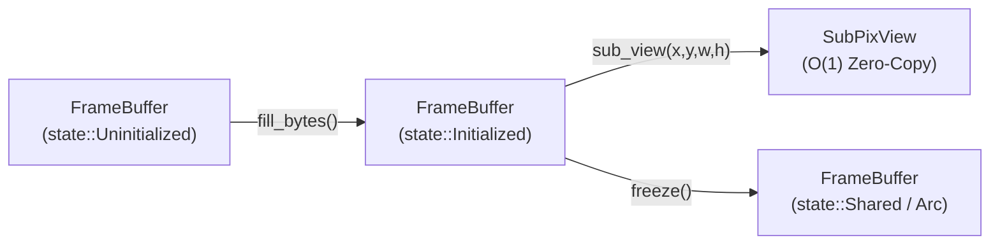

# Core Primitives & Memory Architecture

At the heart of `oxipix` is `oxipix-core`, a low-level, zero-overhead foundation for high-throughput image manipulation.



---

## 1. 64-Byte Cache-Line Alignment (`AlignedBuffer`)

Standard Rust allocations (`Vec<u8>`) are aligned to a single byte (`align_of::<u8>() == 1`). When feeding memory directly into AVX2, AVX-512, or ARM NEON vector units, unaligned loads incur significant latency penalties or hardware faults.

`AlignedBuffer<const ALIGN: usize = 64>` allocates memory guaranteed to align to 64-byte hardware cache lines:

```rust
use oxipix::AlignedBuffer;

fn main() -> Result<(), oxipix::OxipixError> {
    // Allocate 1 MB aligned to 64 bytes
    let buf: AlignedBuffer<64> = AlignedBuffer::allocate(1024 * 1024)?;

    assert!(buf.is_aligned());
    assert_eq!(buf.len(), 1024 * 1024);

    // AlignedBuffer implements Deref and DerefMut to [u8]
    let slice: &[u8] = &buf;
    println!("Allocated aligned buffer at {:p}", slice.as_ptr());

    Ok(())
}
```

---

## 2. Typestate Pattern for Safe Frame Lifecycle

`FrameBuffer<Format, State>` prevents access to uninitialized memory at compile time through the Rust typestate pattern:

| Typestate              | Meaning                          | Permitted Operations                                     |
|:-----------------------|:---------------------------------|:---------------------------------------------------------|
| `state::Uninitialized` | Raw heap allocated, zero-filled  | `fill_bytes(val)` to initialize                          |
| `state::Initialized`   | Verified valid pixel buffer      | `as_bytes()`, `as_bytes_mut()`, `sub_view()`, `freeze()` |
| `state::Shared`        | Read-only thread-safe Arc buffer | `as_bytes()`, `clone()`, concurrent distribution         |

### Example Lifecycle

```rust
use oxipix::{FrameBuffer, PixelWidth, PixelHeight, Rgba8, state};

fn process_camera_stream() -> Result<(), oxipix::OxipixError> {
    // Step 1: Pre-allocate uninitialized memory
    let frame_uninit = FrameBuffer::<Rgba8, state::Uninitialized>::allocate(
        PixelWidth(3840),
        PixelHeight(2160),
    )?;

    // Step 2: Initialize pixel memory (transitions state)
    let mut frame_init = frame_uninit.fill_bytes(128);

    // Step 3: Mutate pixels directly
    let raw_mut = frame_init.as_bytes_mut();
    raw_mut[0] = 255;

    // Step 4: Freeze into shared memory
    let shared_frame = frame_init.freeze();
    
    // Now safely clone across threads without copying pixel bytes
    let consumer_handle = shared_frame.clone();
    std::thread::spawn(move || {
        println!("Consumer read {} bytes", consumer_handle.as_bytes().len());
    }).join().unwrap();

    Ok(())
}
```

---

## 3. Zero-Allocation Sub-Views (`SubPixView`)

In standard image crates, cropping an image requires re-allocating a new buffer and copying rows:

```rust
// Legacy: Incurs heap allocation and memcpy for every crop
let cropped = imageops::crop_imm(&img, x, y, w, h).to_image();
```

With `oxipix::SubPixView`, cropping is an **$O(1)$ pointer-arithmetic operation** that borrows the parent buffer with stride calculations:

```rust
use oxipix::{FrameBuffer, PixelWidth, PixelHeight, Rgba8, state};

fn detect_license_plate(frame: &FrameBuffer<Rgba8, state::Initialized>) -> Result<(), oxipix::OxipixError> {
    // Zero allocations: borrows frame with origin offset and stride
    let plate_roi = frame.sub_view(500, 400, 200, 80)?;

    assert_eq!(plate_roi.width().get(), 200);
    assert_eq!(plate_roi.height().get(), 80);

    // Access specific rows in O(1)
    for y in 0..plate_roi.height().get() as usize {
        let row_bytes: &[u8] = plate_roi.row(y)?;
        assert_eq!(row_bytes.len(), 200 * 4);
    }

    Ok(())
}
```

---

## 4. Pixel Format Descriptors

`oxipix-core` provides strongly typed descriptors that encode channel counts and memory layout:

```rust
use oxipix::{Rgba8, Rgb8, Luma8, PixelFormatDescriptor};

fn inspect_format<F: PixelFormatDescriptor>() {
    println!(
        "Format {}: {} bytes/pixel, {} channels",
        F::NAME,
        F::BYTES_PER_PIXEL,
        F::CHANNELS
    );
}

fn main() {
    inspect_format::<Rgba8>(); // RGBA8: 4 bytes/pixel, 4 channels
    inspect_format::<Rgb8>();  // RGB8: 3 bytes/pixel, 3 channels
    inspect_format::<Luma8>(); // Luma8: 1 bytes/pixel, 1 channels
}
```
