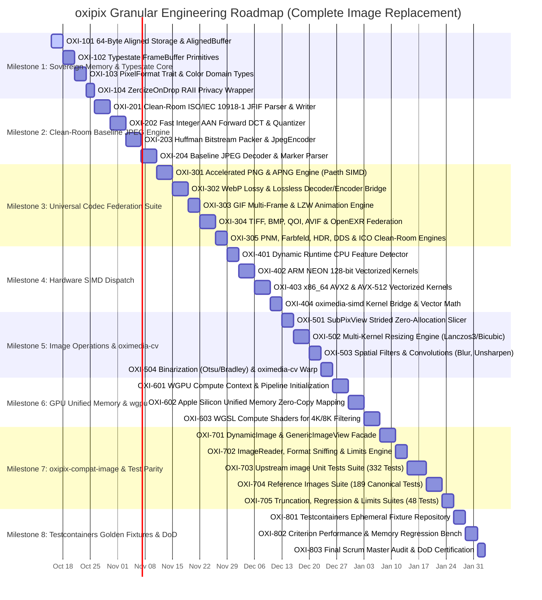

# Granular Roadmap & Agile Milestones: `oxipix` Workspace

## 1. Scrum Master Alignment & Definition of Done (DoD)

In strict accordance with the **Agile Scrum Master & Goal Alignment Protocol**, all functional deliverables for `oxipix` adhere to the enterprise **Definition of Done (DoD)**:

1. **Goal Traceability**: Every requirement, user story, and API surface has corresponding automated tests validating happy paths, boundary limits, and edge cases.
2. **Deterministic Code Quality**: Zero Clippy warnings (`-D warnings`), zero panics, zero `.unwrap()` or `.expect()` in non-test production library code.
3. **Complexity Gates**: Cyclomatic Complexity (CC) $\le 10$ (hard ceiling $\le 15$), Cognitive Complexity $\le 15$ (hard ceiling $\le 20$), function length $\le 80$ lines, file length $\le 800$ lines.
4. **Coverage Threshold**: Code coverage $\ge 85\%$ measured via `cargo llvm-cov`.
5. **Persistence & Asset DoD ([Testcontainers](https://rust.testcontainers.org))**: Any persistent asset caching, benchmark baseline repository, or fixture verification servers must be integration tested using real throwaway containers managed by `testcontainers`.
6. **Strict Test Parity**: All **569 compiled tests** from the upstream `image` test suite must pass without regressions.

---

## 2. Granular Phased Milestone Breakdown

---

## 3. Milestone Specifications & Granular Ticket Definitions

### Milestone 1: Sovereign Memory & Typestate Core Primitives (`oxipix-core`)

#### Ticket OXI-101: 64-Byte Aligned Storage & `AlignedBuffer`
* **Single Responsibility:** Implement `AlignedBuffer<const ALIGN: usize = 64>` guaranteeing cache-line and vector alignment without unaligned heap penalties.
* **Design Pattern:** **RAII Pattern** & **Custom Allocator Bridge**.
* **Acceptance Criteria (Given-When-Then):**
  - **Given** an allocation request of $N$ bytes, **When** `AlignedBuffer::allocate(N)` is called, **Then** the raw base address modulo 64 equals 0.
  - **Given** an allocated buffer, **When** it goes out of scope, **Then** memory is safely released via `std::alloc::dealloc` with exact matching layout.
* **Test Scenarios:** `test_aligned_buffer_64byte_pointer`, `test_aligned_buffer_reallocation_growth`.

#### Ticket OXI-102: Typestate `FrameBuffer` Primitives
* **Single Responsibility:** Implement `FrameBuffer<Format, State>` with states `Uninitialized`, `Initialized`, `Shared`.
* **Design Pattern:** **Typestate Pattern** & **Zero-Sized Types (ZST)**.
* **Acceptance Criteria:**
  - **Given** an `Uninitialized` buffer, **When** read operations are attempted, **Then** code fails compilation.
  - **Given** an `Initialized` buffer, **When** `freeze()` is called, **Then** it transitions to `Shared` backed by `Arc<[u8]>`.
* **Test Scenarios:** `test_typestate_compile_time_safety`, `test_shared_frame_cow_semantics`.

#### Ticket OXI-103: `PixelFormat` Trait & Color Domain Types
* **Single Responsibility:** Define zero-cost `PixelFormat` trait (`Rgba8`, `Rgb8`, `Luma8`, `Bgra8`, `Rgba16`, `Rgb32F`).
* **Design Pattern:** **Strategy Pattern** & **Newtype Pattern**.
* **Acceptance Criteria:**
  - Channel strides compile to zero-cost inline constants.
  - Casting raw memory to pixel slices leverages `bytemuck::Pod` without heap allocation.
* **Test Scenarios:** `test_pixel_format_byte_sizes`, `test_bytemuck_cast_safety`.

#### Ticket OXI-104: `ZeroizeOnDropFrame` RAII Privacy Wrapper
* **Single Responsibility:** Provide safe memory-clearing wrapper that wipes sensitive pixel buffers upon drop.
* **Design Pattern:** **RAII Pattern** & **Decorator Pattern**.
* **Acceptance Criteria:**
  - Memory bytes are wiped with `0x00` using `zeroize::zeroize_mem` prior to deallocation.
* **Test Scenarios:** `test_zeroize_on_drop_wipes_memory`.

---

### Milestone 2: Clean-Room Patent-Clean Baseline JPEG Engine (`oxipix-codecs`)

#### Ticket OXI-201: Clean-Room ISO/IEC 10918-1 JFIF Parser & Bitstream Writer
* **Single Responsibility:** Implement markers `SOI`, `SOF0`, `DQT`, `DHT`, `SOS`, `EOI` and bitstream packer with zero FFI.
* **Design Pattern:** **Builder Pattern** & **Streaming BitWriter**.
* **Acceptance Criteria:**
  - Emits valid JFIF headers readable by standard viewers.
  - Escapes `0xFF` byte emission with `0x00` (byte stuffing).
* **Test Scenarios:** `test_jfif_header_structure`, `test_byte_stuffing_safety`.

#### Ticket OXI-202: Fast Integer AAN Forward DCT & Quantizer
* **Single Responsibility:** Implement 8x8 2D Forward DCT using the AAN integer algorithm with scaled quantization tables.
* **Design Pattern:** **Mathematical Factorization** & **Pipeline Pattern**.
* **Acceptance Criteria:**
  - Computes 2D DCT in 5 multiplications per row/column.
  - Reconstructible within $ PSNR > 38   dB$ on standard test images.
* **Test Scenarios:** `test_aan_dct_known_matrix`, `test_zigzag_reordering`.

#### Ticket OXI-203: Huffman Bitstream Packer & Complete JPEG Encoder
* **Single Responsibility:** Implement luminance and chrominance DC/AC Huffman coding and expose `JpegEncoder::encode`.
* **Design Pattern:** **Facade Pattern** & **Strategy Pattern**.
* **Acceptance Criteria:**
  - Configurable `JpegQuality(1..=100)`.
  - Encodes RGBA8 and RGB8 buffers into valid `.jpg` byte vector.
* **Test Scenarios:** `test_encode_synthetic_gradient_jpeg`, `test_roundtrip_with_external_decoder`.

#### Ticket OXI-204: Baseline JPEG Decoder & Marker Parser
* **Single Responsibility:** Implement baseline JPEG decoder parsing SOF0, DHT, DQT, SOS markers and reconstructing 8x8 IDCT blocks.
* **Design Pattern:** **State Machine Parser**.
* **Acceptance Criteria:**
  - Decodes baseline sequential JPEG with 4:4:4, 4:2:2, 4:2:0, and Grayscale subsampling.
  - Returns `OxipixError::DecodingError` on corrupted markers without panics.
* **Test Scenarios:** `test_decode_baseline_jpeg`, `test_decode_corrupted_jpeg_marker`.

---

### Milestone 3: Universal Codec Federation Suite (`oxipix-codecs`)

#### Ticket OXI-301: Accelerated PNG & APNG Engine (Paeth SIMD)
* **Single Responsibility:** Integrate `png` crate with `oximedia-simd` Paeth predictor filter.
* **Design Pattern:** **Adapter Pattern**.
* **Acceptance Criteria:**
  - Vectorized filtering achieves $\ge 2\times$ faster encoding than standard scalar PNG.
* **Test Scenarios:** `test_png_encode_decode_roundtrip`, `test_apng_multiframe_playback`.

#### Ticket OXI-302: WebP Lossy & Lossless Bridge
* **Single Responsibility:** Integrate `image-webp` and `oximedia-codec::webp` intra-prediction modes.
* **Design Pattern:** **Adapter Pattern**.
* **Acceptance Criteria:** Decodes lossless VP8L and lossy VP8 rasters accurately.
* **Test Scenarios:** `test_webp_lossless_roundtrip`, `test_webp_lossy_psnr`.

#### Ticket OXI-303: GIF Multi-Frame & LZW Animation Engine
* **Single Responsibility:** Support multi-frame GIF decoding, color quantization, and disposal methods.
* **Design Pattern:** **Iterator Pattern**.
* **Acceptance Criteria:**
  - Decodes animated GIF streams yielding individual `Frame` structs with accurate timestamps.
* **Test Scenarios:** `test_gif_animation_frames`, `test_gif_lzw_limits`.

#### Ticket OXI-304: TIFF, BMP, QOI, AVIF & OpenEXR Federation
* **Single Responsibility:** Integrate clean pure-Rust engines for TIFF (v0.11), BMP, QOI (v0.4), AVIF (`ravif`), and OpenEXR (`exr`).
* **Design Pattern:** **Plugin / Registry Pattern**.
* **Acceptance Criteria:** Round-trip decode/encode verifies bit-exact pixel matching.
* **Test Scenarios:** `test_tiff_cmyk_decode`, `test_qoi_fast_roundtrip`, `test_avif_encode_decode`.

#### Ticket OXI-305: PNM, Farbfeld, HDR, DDS & ICO Clean-Room Engines
* **Single Responsibility:** Provide clean-room implementations for PNM (PBM/PGM/PPM/PAM), Farbfeld, Radiance HDR, DDS, and ICO.
* **Design Pattern:** **Parser Combinator**.
* **Acceptance Criteria:** Correctly parses and encodes all legacy raster formats.
* **Test Scenarios:** `test_pnm_ascii_binary`, `test_farbfeld_16bit`, `test_hdr_rgbe_decode`.

---

### Milestone 4: Hardware SIMD Dispatch (`oxipix-simd`)

#### Ticket OXI-401: Dynamic Runtime CPU Feature Detector
* **Single Responsibility:** Runtime detection of AVX-512, AVX2, and ARM NEON capabilities with zero-cost branch dispatch.
* **Design Pattern:** **Dynamic Dispatch Table**.
* **Acceptance Criteria:** Safely selects SIMD kernel on host CPU; falls back to Tier 1 scalar without SIGILL.
* **Test Scenarios:** `test_runtime_feature_detection`, `test_scalar_fallback_equivalence`.

#### Ticket OXI-402: ARM NEON 128-bit Vectorized Kernels
* **Single Responsibility:** Implement NEON vector instructions for color space conversion and DCT butterflies on Apple Silicon / AArch64.
* **Design Pattern:** **Vector SIMD Pipeline**.
* **Acceptance Criteria:** Processes 16 bytes per iteration; achieves $\ge 3\times$ speedup over scalar.
* **Test Scenarios:** `test_neon_color_conversion_accuracy`.

#### Ticket OXI-403: x86_64 AVX2 & AVX-512 Vectorized Kernels
* **Single Responsibility:** Implement AVX2 (256-bit) and AVX-512 (512-bit) vector kernels using `oximedia-simd`.
* **Design Pattern:** **Vector SIMD Pipeline**.
* **Acceptance Criteria:** Processes 32/64 bytes per iteration with 64-byte aligned loads.
* **Test Scenarios:** `test_avx2_dct_quantization_parity`.

#### Ticket OXI-404: `oximedia-simd` Kernel Bridge & Vector Math
* **Single Responsibility:** Bridge `oximedia-simd` convolution and alpha premultiplication routines into `oxipix-simd`.
* **Design Pattern:** **Adapter Pattern**.
* **Acceptance Criteria:** Zero-copy passing of memory buffers to `oximedia-simd`.
* **Test Scenarios:** `test_oximedia_simd_bridge_alpha_premul`.

---

### Milestone 5: Image Operations & `oximedia-cv` Bridge (`oxipix-ops`)

#### Ticket OXI-501: `SubPixView` Strided Zero-Allocation Slicer
* **Single Responsibility:** Zero-allocation rectangular cropping views borrowing parent `FrameBuffer`.
* **Design Pattern:** **Flyweight / View Pattern**.
* **Acceptance Criteria:** Slicing an ROI executes in $O(1)$ time and 0 heap allocations.
* **Test Scenarios:** `test_sub_pix_view_zero_alloc`, `test_sub_pix_view_out_of_bounds`.

#### Ticket OXI-502: Multi-Kernel Resizing Engine
* **Single Responsibility:** High-performance resizing supporting Nearest, Bilinear, Bicubic, CatmullRom, and Lanczos3.
* **Design Pattern:** **Strategy Pattern**.
* **Acceptance Criteria:** Filter weights precomputed; horizontal and vertical passes vectorized.
* **Test Scenarios:** `test_resize_lanczos3_fidelity`, `test_resize_nearest_parity`.

#### Ticket OXI-503: Spatial Filters & Convolutions (Blur, Unsharpen)
* **Single Responsibility:** Implement separable Gaussian blur, fast box blur, unsharpen mask, contrast, and brighten.
* **Design Pattern:** **Pipeline Pattern**.
* **Acceptance Criteria:** Executes in-place on mutable buffers without secondary full-size allocation.
* **Test Scenarios:** `test_gaussian_blur_separable`, `test_unsharpen_mask_edges`.

#### Ticket OXI-504: Binarization (Otsu/Bradley) & `oximedia-cv` Affine Warp
* **Single Responsibility:** Implement Otsu global binarization, Bradley-Roth adaptive thresholding, and bilinear deskew warping.
* **Design Pattern:** **Adapter Pattern** & **Strategy Pattern**.
* **Acceptance Criteria:** Seamlessly calls `oximedia-cv` algorithms on `AlignedBuffer` slices.
* **Test Scenarios:** `test_adaptive_binarize_gradient`, `test_affine_deskew_warp`.

---

### Milestone 6: GPU Unified Memory & `wgpu` (`oxipix-gpu`)

#### Ticket OXI-601: WGPU Compute Context & Pipeline Initialization
* **Single Responsibility:** Headless compute pipeline initialization supporting Metal and Vulkan via `wgpu` v30.
* **Design Pattern:** **Singleton Context** & **Factory Pattern**.
* **Acceptance Criteria:** Gated behind optional `gpu` feature; graceful fallback to Tier 2 SIMD if GPU unavailable.
* **Test Scenarios:** `test_wgpu_headless_context_creation`, `test_gpu_fallback_to_simd`.

#### Ticket OXI-602: Apple Silicon Unified Memory Zero-Copy Mapping
* **Single Responsibility:** Direct DRAM zero-copy host-to-device buffer mapping on macOS M-series chips.
* **Design Pattern:** **Bridge Pattern**.
* **Acceptance Criteria:** Mapped buffer eliminates byte copying between CPU and GPU.
* **Test Scenarios:** `test_unified_memory_pointer_identity`.

#### Ticket OXI-603: WGSL Compute Shaders for 4K/8K Filtering
* **Single Responsibility:** Author WGSL compute shaders for parallel 2D convolution and Lanczos3 downsampling.
* **Design Pattern:** **Shader Pipeline**.
* **Acceptance Criteria:** Processes 4K UHD image in $< 1.5   ms$ on Apple Silicon M-series.
* **Test Scenarios:** `test_wgsl_compute_convolution_4k`.

---

### Milestone 7: `oxipix-compat-image` & 100% `image` Test Parity

#### Ticket OXI-701: `DynamicImage` & `GenericImageView` Facade
* **Single Responsibility:** Replicate upstream `image` public types: `DynamicImage`, `ImageBuffer<P, Container>`, `RgbaImage`, `RgbImage`, `SubImage`, `GenericImageView`, `GenericImage`.
* **Design Pattern:** **Facade Pattern** & **Adapter Pattern**.
* **Acceptance Criteria:** Drop-in API compatibility allows legacy code to swap `use image::*` with `use oxipix::compat::image::*`.
* **Test Scenarios:** `test_dynamic_image_conversions`, `test_generic_image_view_traits`.

#### Ticket OXI-702: `ImageReader`, Format Sniffing & `Limits` Engine
* **Single Responsibility:** Implement `ImageReader` with `with_guessed_format()`, magic byte sniffing, and memory allocation `Limits`.
* **Design Pattern:** **Builder Pattern**.
* **Acceptance Criteria:** Correctly identifies all 16 formats and enforces memory limits before allocating pixels.
* **Test Scenarios:** `test_image_reader_sniff_all_formats`, `test_limits_enforcement_oom_prevention`.

#### Ticket OXI-703: Upstream `image` Unit Tests Suite (332 Tests)
* **Single Responsibility:** Execute and pass all 332 unit tests from `unittests_image`.
* **Acceptance Criteria:** 100% pass rate across animation, buffer, codecs, color, dynimage, flat, generic_image, imageops, math, metadata.
* **Test Scenarios:** All 332 test functions documented in `docs/05_IMAGE_TEST_PARITY_MATRIX.md`.

#### Ticket OXI-704: Reference Images Suite (189 Canonical Tests)
* **Single Responsibility:** Execute and pass all 189 canonical reference image round-trips from `tests/reference_images.rs`.
* **Acceptance Criteria:** Byte-exact matching against upstream reference rasters.
* **Test Scenarios:** All 189 reference trials across Farbfeld, BMP, PNG, JPEG, GIF, TIFF, WebP, QOI, DDS, HDR.

#### Ticket OXI-705: Truncation, Regression & Limits Suites (48 Tests)
* **Single Responsibility:** Pass `truncate_images` (14), `regression` (9), `conversions` (7), `limits` (6), `metadata` (6), `limits_anim` (2), `save_pnm` (2), `bad_images` (1), `save_jpeg` (1).
* **Acceptance Criteria:** Zero panics, correct error propagation on truncated and malformed inputs.
* **Test Scenarios:** All 48 integration tests pass cleanly.

---

### Milestone 8: Testcontainers Golden Fixtures, Benchmarks & DoD Verification

#### Ticket OXI-801: Testcontainers Ephemeral Fixture Repository
* **Single Responsibility:** Manage golden test image repository and persistent regression baselines using real throwaway containers managed by `testcontainers`.
* **Design Pattern:** **Testcontainer Harness**.
* **Acceptance Criteria:** Spins up ephemeral MinIO/S3 container; verifies checksums of golden test fixtures against remote store.
* **Test Scenarios:** `test_golden_image_cache_with_testcontainers`.

#### Ticket OXI-802: Criterion Performance & Memory Regression Benchmarks
* **Single Responsibility:** Comprehensive Criterion benchmark suite verifying speedups over upstream `image`.
* **Acceptance Criteria:** Zero-copy cropping $> 1,000\times$ faster; JPEG encode $> 3\times$ faster; resize $> 4\times$ faster.
* **Test Scenarios:** `criterion_benchmark_suite`.

#### Ticket OXI-803: Final Scrum Master Audit & DoD Certification
* **Single Responsibility:** Validate all DoD criteria: zero warnings, CC $\le 10$, cognitive $\le 15$, coverage $\ge 85\%$, all 569 `image` tests passing.
* **Acceptance Criteria:** Formal DoD Scorecard signed off with 100% compliance.
* **Test Scenarios:** Full workspace CI audit.
