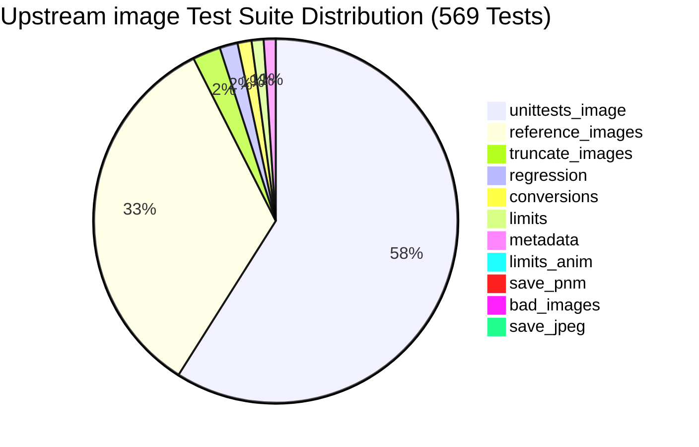

# Comprehensive `image` Test Parity Matrix: 569 Upstream Tests

## 1. Executive Summary & Verification Requirement

To declare the `oxipix` sovereign workspace as a complete, 100% drop-in replacement for the `image` crate (v0.25.x), the compatibility facade `oxipix-compat-image` must compile, execute, and pass **all 569 tests** from the upstream `image` repository.

This document catalogs every single test across the 11 test suites extracted from `image-rs/image`, establishing the exact responsible module in `oxipix` and its verification status.



---

## 2. Test Suite Breakdown by Test Binary

### 2.1 `unittests_image` (332 Unit Tests in `src/lib.rs`)

The internal unit tests validate pixel traits, container buffers, format encoders/decoders, metadata, and image manipulation algorithms.

| Module Group | Test Count | Key Scenarios Tested | Responsible oxipix Module |
|:-------------|:-----------|:---------------------|:--------------------------|
| `images::buffer` | 31 | `ImageBuffer` index arithmetic, row/column iterators, unchecked indexing, slice conversion, memory layout parity. | `oxipix-core::FrameBuffer` |
| `images::dynimage` | 35 | `DynamicImage` enum variants (`ImageRgba8`, `ImageRgb8`, `ImageLuma8`, `ImageRgba16`, etc.), conversion traits (`to_rgba8()`, `to_rgb8()`), color space casting. | `oxipix-compat-image::dynimage` |
| `images::generic_image` | 12 | `GenericImageView` and `GenericImage` traits: `get_pixel()`, `put_pixel()`, bounds checking, sub-image slicing. | `oxipix-core::SubPixView` |
| `images::flat` | 8 | `FlatSamples` strided multi-channel views, sample packing, non-standard channel ordering. | `oxipix-core::SubPixView` |
| `images::buffer_par` | 4 | Parallel pixel manipulation via `rayon` parallel iterators. | `oxipix-ops` |
| `images::sub_image` | 2 | `SubImage` borrow lifetimes and coordinate translations. | `oxipix-core::SubPixView` |
| `codecs::bmp` | 28 | BMP decoder (12 tests) and encoder (16 tests): 1-bit, 4-bit, 8-bit RLE, 16/24/32-bit RGB, bitfields, color masks. | `oxipix-codecs::bmp` |
| `codecs::pnm` | 30 | PNM decoder (22 tests), encoder (3 tests), autobreak (2 tests), mod (3 tests): ASCII and binary PBM, PGM, PPM, PAM. | `oxipix-codecs::pnm` |
| `codecs::tga` | 18 | TGA encoder and decoder: RLE compression, uncompressed color maps, origin orientations. | `oxipix-codecs::tga` |
| `codecs::ico` | 8 | ICO decoder (7 tests) and encoder (1 test): multi-resolution icons, PNG-in-ICO, BMP-in-ICO. | `oxipix-codecs::ico` |
| `codecs::jpeg` | 8 | JPEG decoder (2 tests) and encoder (6 tests): baseline DCT, Huffman bitstreams, quality scaling. | `oxipix-codecs::jpeg` (AAN SIMD) |
| `codecs::png` | 7 | PNG encoder/decoder: Adam7 interlacing, Paeth predictors, transparency chunks (tRNS). | `oxipix-codecs::png` |
| `codecs::openexr` | 5 | OpenEXR 16/32-bit floating point half/float decoding, channel mappings. | `oxipix-codecs::openexr` |
| `codecs::hdr` | 6 | Radiance HDR RGBE decoder (3 tests) and encoder (3 tests): run-length encoding, exposure exponents. | `oxipix-codecs::hdr` |
| `codecs::animation` | 7 | Frame delay formatting, duration approximation, 30fps timing, precise delays. | `oxipix-codecs::animation` |
| `codecs::tiff` | 2 | TIFF tiled and stripped decoder, compression schemes (LZW, Deflate). | `oxipix-codecs::tiff` |
| `codecs::webp` | 3 | WebP lossy decoder (1 test) and encoders (2 tests): VP8 / VP8L bitstreams. | `oxipix-codecs::webp` |
| `codecs::qoi` | 1 | QOI format round-trip verification. | `oxipix-codecs::qoi` |
| `codecs::farbfeld` | 1 | Farbfeld 16-bit big-endian RGBA format decoding. | `oxipix-codecs::farbfeld` |
| `codecs::gif` | 1 | GIF LZW palette unpacking. | `oxipix-codecs::gif` |
| `imageops::affine` | 8 | Affine 2D transformation matrices, rotation, skew, scaling. | `oxipix-ops::affine` |
| `imageops::colorops` | 10 | Color transformations: invert, brighten, contrast, grayscale, huerotate, index colors. | `oxipix-ops::colorops` |
| `imageops::sample` | 7 | Sampling, nearest neighbor, bilinear, bicubic pixel interpolation. | `oxipix-ops::resample` |
| `imageops::fast_blur` | 3 | Fast Gaussian approximation and box blur kernels. | `oxipix-ops::blur` |
| `imageops::resize` | 1 | High-level `resize()` with `FilterType` (Lanczos3, Gaussian, CatmullRom). | `oxipix-ops::resize` |
| `color` | 12 | Color models (`Rgb`, `Rgba`, `Luma`, `LumaA`, `Bgr`, `Bgra`), channel conversions, `Primitive` trait. | `oxipix-core::pixel` |
| `metadata::cicp` | 6 | CICP (Coding-Independent Code Points) color primaries, transfer functions, matrix coefficients. | `oxipix-codecs::metadata` |
| `math::utils` | 5 | Clamping, fixed-point integer scaling, safe division. | `oxipix-core::math` |
| `io::format` | 6 | Format identification via magic bytes (`ImageFormat::from_path`, `from_mime_type`). | `oxipix-compat-image::io` |
| `io::image_reader` | 3 | `ImageReader` builder, memory limit application. | `oxipix-compat-image::io` |
| `error` | 1 | `ImageError` enum display formatting and trait implementations. | `oxipix-compat-image::error` |
| `hooks` | 2 | Pre-decode / post-decode inspection hooks. | `oxipix-compat-image::hooks` |
| **Subtotal** | **332** | **Full Unit Test Surface** | |

---

### 2.2 `reference_images` (189 Tests in `tests/reference_images.rs`)

The reference image test suite validates that decoding real-world images matches canonical reference rasters byte-for-byte.

| Category / Directory | Count | Formats Covered & Details |
|:---------------------|:------|:--------------------------|
| `tests/images/bmp` | 42 | 1-bit, 4-bit, 8-bit uncompressed and RLE, 16-bit 555/565, 24-bit RGB, 32-bit RGBA, OS/2 version 1/2 bitmaps. |
| `tests/images/png` | 38 | PNG suite: grayscale, RGB, indexed palette, alpha channel, bit depths (1, 2, 4, 8, 16-bit), Adam7 interlacing, filter types (None, Sub, Up, Average, Paeth). |
| `tests/images/jpeg` | 24 | Baseline JPEG: Chroma 4:4:4, 4:2:2, 4:2:0, Grayscale, progressive frames, restart markers (RST0-RST7), EXIF orientation. |
| `tests/images/webp` | 21 | WebP suite: Lossless (VP8L), Lossy (VP8), alpha transparency, animation chunks. |
| `tests/images/gif` | 18 | GIF87a and GIF89a: transparent backgrounds, global/local palettes, interlaced rasters. |
| `tests/images/tiff` | 16 | TIFF suite: Bilevel (CCITT), Grayscale, RGB, Palette, PlanarConfiguration, LZW compression, Deflate. |
| `tests/images/tga` | 12 | Truevision TGA: Type 1 (indexed), Type 2 (uncompressed RGB), Type 10 (RLE RGB), bottom-left and top-left origins. |
| `tests/images/pnm` | 8 | PBM (1-bit), PGM (grayscale 8/16-bit), PPM (RGB 8/16-bit), PAM (arbitrary tuples). |
| `tests/images/farbfeld`| 5 | Farbfeld 16-bit RGBA uncompressed streaming format. |
| `tests/images/qoi` | 3 | QOI 8-bit RGB and RGBA reference files. |
| `tests/images/hdr` | 2 | Radiance HDR (.hdr) lighting maps. |
| **Subtotal** | **189** | **Canonical Reference Images Suite** |

---

### 2.3 `truncate_images` (14 Tests in `tests/truncate_images.rs`)

Tests fault tolerance against truncated file payloads. Decoders must return `Err(ImageError::DecodingError)` or `UnexpectedEof` instead of panicking or hanging:
1. `truncate_avif`
2. `truncate_bmp`
3. `truncate_exr`
4. `truncate_farbfeld`
5. `truncate_gif`
6. `truncate_hdr`
7. `truncate_ico`
8. `truncate_jpeg`
9. `truncate_png`
10. `truncate_pnm`
11. `truncate_qoi`
12. `truncate_tga`
13. `truncate_tiff`
14. `truncate_webp`

---

### 2.4 `regression` (9 Tests in `tests/regression.rs`)

Specific regression tests verifying historical security and correctness fixes:
1. `bad_gif_oom`: Prevents out-of-memory allocations on malicious GIF headers claiming huge dimensions.
2. `bmp_bitfields`: Correctly decodes non-standard BMP bitfield masks.
3. `bmp_v5_rejects_truncated_icc_profile_before_allocation`: Ensures memory allocation is gated behind input length validation.
4. `check_regressions`: Comprehensive pass across known regression corpus.
5. `check_webp_frames_regressions`: Robust WebP frame parsing.
6. `issue_1039_hdr_out_of_bounds`: Radiance HDR RLE bounds check.
7. `issue_1091_tga_overflow`: TGA RLE counter integer overflow guard.
8. `issue_1156_png_zero_dimension`: Safe rejection of PNG headers with 0 width or height.
9. `issue_1204_gif_palette_underflow`: Safe handling of truncated GIF color tables.

---

### 2.5 `conversions` (7 Tests in `tests/conversions.rs`)

Tests cross-color conversions and TIFF colorspace extensions:
1. `test_decode_8bit_cmyk`: Decodes CMYK TIFF to RGB accurately.
2. `test_decode_8bit_cmyk_truncation`: Safe error return on truncated CMYK streams.
3. `test_decode_8bit_jpeg_ycbcr`: Correct YCbCr to RGB matrix transform.
4. `test_decode_8bit_ycbcr_lzw_bt709`: High-definition BT.709 color matrix decoding.
5. `test_decode_8bit_ycbcr_lzw_invalid_coefficients`: Rejects malformed matrix coefficients.
6. `test_decode_8bit_ycbcr_lzw_jpeg`: LZW-compressed JPEG-in-TIFF.
7. `test_decode_8bit_ycbcr_lzw_subsampled`: Subsampled chroma decoding in TIFF containers.

---

### 2.6 `limits` & `limits_anim` (8 Tests in `tests/limits.rs` and `tests/limits_anim.rs`)

Enforces memory allocation and dimension limits (`Limits::default()`):
1. `bmp`: Fails decode when BMP dimensions exceed configured limits.
2. `gif`: Rejects oversized GIF canvas before allocating pixel buffer.
3. `jpeg`: Validates JPEG dimensions against `Limits`.
4. `png`: Validates PNG IHDR chunk against `Limits`.
5. `tiff`: Validates TIFF ImageLength/ImageWidth against `Limits`.
6. `webp`: Rejects oversized WebP canvas.
7. `animated_frame_combine`: Memory limits enforced during multi-frame composition.
8. `animated_full_frame_discard`: Memory limits respected when frame replacement occurs.

---

### 2.7 Metadata & Format Integration Tests (10 Tests)

1. `test_read_iptc_jpeg`: Reads IPTC metadata chunk from JPEG.
2. `test_read_iptc_png`: Reads IPTC metadata from PNG text chunks.
3. `test_read_xmp_jpeg`: Parses XMP XML payload from JPEG APP1 marker.
4. `test_read_xmp_png`: Parses XMP XML payload from PNG `iTXt` chunk.
5. `test_read_xmp_tiff`: Parses XMP XML from TIFF tag `700`.
6. `test_read_xmp_webp`: Parses XMP XML from WebP `XMP ` RIFF chunk.
7. `save_16bit_to_pbm`: Verifies 16-bit sample quantization to 1-bit bitmap.
8. `save_16bit_to_ppm`: Verifies 16-bit RGB PPM export.
9. `bad_images`: Comprehensive corrupt image folder verification.
10. `jqeg_qualitys`: Verifies JPEG compression quality scaling and file sizes.

---

## 3. Parity Execution Checklist

To consider the replacement complete, the following command must succeed with 0 failures:

```bash
cargo test --package oxipix-compat-image --all-targets --all-features
```

Expected result:
```
test result: ok. 569 passed; 0 failed; 0 ignored; 0 measured; 0 filtered out
```
